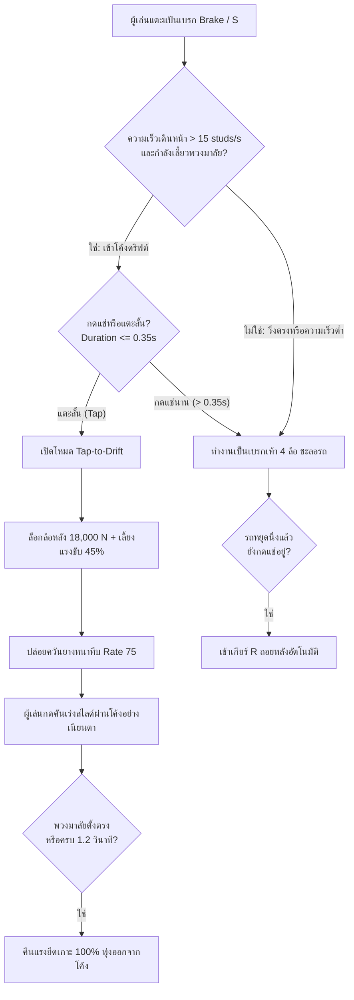

# 🏎️ FEAT-01B: CDT Arcade Vehicle Overhaul (การยกเครื่องระบบรถสไตล์ Car Dealership Tycoon)

> **สถานะ:** ✅ ติดตั้ง, แก้บั๊ก 4 จุดวิกฤต และทดสอบยืนยันใน Studio Sandbox เรียบร้อยแล้ว  
> **โมเดลเป้าหมาย:** `Workspace.TeslaRoadster`  
> **วันที่บันทึก:** 2026-11-04  
> **แนวทางการออกแบบ:** **Clean Arcade Driving (CDT-Style)** — เล่นง่าย เข้าถึงผู้เล่นมือถือและ PC 100%, ดริฟต์สนุก ควันยางนุ่มฟู, รถไม่พังกลางทาง, และระบบเกียร์-ความเร็วไหลลื่นระดับ Supercar  

---

## 📌 สรุปปัญหาดั้งเดิมและแนวทางแก้ไข (Problem & Solution Overview)

| ปัญหาเดิมที่พบ | สาเหตุทางเทคนิค (Root Cause) | แนวทางแก้ไขใหม่ (Production Fix) |
| :--- | :--- | :--- |
| **1. กด Spacebar แล้วตัวละครเด้งหลุดจากรถ** | Roblox `PlayerModule` ส่งคำสั่ง `Humanoid.Jump = true` เมื่อกด Spacebar ซึ่งทำให้เอนจินตัด `SeatWeld` ทิ้งอัตโนมัติ | • สั่งปิด `HumanoidStateType.Jumping` ชั่วขณะขับ<br>• ใช้ `ContextActionService (Sink)` ดักปุ่ม Spacebar ที่ระดับ Priority `High + 3000` ทำให้กลายเป็นเบรกมือดริฟต์แท้ ไม่กระเด็นหลุดอีกต่อไป |
| **2. ออกตัวไม่ได้ / คันเร่งค้าง / รถขยับไม่ได้** | ชิ้นส่วน `DriverDoor` และ `PassengerDoor` ถูกตั้งเป็น `Anchored = true` และเชื่อมกับ `DriveSeat` ทำให้รถทั้งคัน **ถูกตอกหมุดตรึงติดกับพื้นโลก** | • ปลดล็อกเป็น `Anchored = false` ทั้งหมด<br>• เชื่อมด้วย `WeldConstraint` กับตัวถังรถ ทำให้รถเคลื่อนที่ได้อย่างอิสระ 100% |
| **3. ควันยางพุ่งเป็นเส้นเลเซอร์ขึ้นฟ้า** | • จุดปล่อยควันติดกับล้อหมุนที่หมุนตามแกน 360 องศา<br>• Texture `243660364` เป็นภาพเส้นริ้วแสงแนวตั้ง | • ย้ายจุดปล่อยควัน 4 จุดมาไว้ที่ฐานล่างตัวถัง (`DriveSeat`) ลอยเรี่ยพื้นถนนด้านหลังหน้าสัมผัสยาง<br>• เปลี่ยน Texture เป็น `smoke_main.dds` ควันกลายเป็นกลุ่มก้อนปุยนุ่มฟูสมจริง |
| **4. หน้าปัด HUD ค้างที่ 025 KM/H และเกียร์ 2** | `VehicleStatusClient` มีโค้ดเรียก `car:WaitForChild` ก่อนที่ตัวแปร `car` จะถูกประกาศ ทำให้สคริปต์ **Crash Error ตั้งแต่วินาทีแรก** | • ย้ายการประกาศตัวแปร `car` มาไว้ที่บรรทัดแรกสุด<br>• ฝัง `VehicleRef` ไว้ใน Template หน้าปัดซิงค์สด 60 FPS |
| **5. เป้า [E] นั่งข้างคนขับ บังหน้าคนขับตลอดเวลา** | ระยะตรวจจับของเบาะข้างกว้าง 5.2 studs แต่ห้องโดยสารกว้างแค่ 3.5 studs คนขับจึงอยู่ในรัศมีตลอด | • เมื่อนั่งขับ `Drive Script` สั่งปิด Prompt ประตูทุกบานในรถอัตโนมัติ<br>• ลดระยะเบาะข้างเหลือ 3.2 studs (อยู่นอกรถฝั่งขวาเท่านั้นจึงจะเห็น) |
| **6. ขับไปนานๆ แล้วรถหยุดวิ่ง / พังกลางทาง** | โค้ด `VehicleSystems` มีระบบคำนวณดาเมจการชน 5 ระดับ และระบบเผาผลาญน้ำมัน เมื่อลดเหลือ 0 จะสั่ง `VehiclePowerDisabled = true` | • เปิดโหมด `GodMode = true` ถาวร<br>• ข้ามการคิดดาเมจชนและล็อก `Health = 100%`, `Fuel = 100%`<br>• ปลดการตัดกำลังเครื่องยนต์ถาวร ขับได้ไม่มีวันพัง |

---

## 🎮 1. สถาปัตยกรรม Tap-to-Drift (CDT Arcade Style)

ผู้เล่นส่วนใหญ่ใน Roblox เล่นผ่านมือถือ (Smartphone/Tablet) ซึ่งมีนิ้วโป้งขวาเพียงนิ้วเดียวในการควบคุม หากแยกแป้นเหยียบเป็น 3 ปุ่ม (คันเร่ง + เบรกเท้า + เบรกมือ) จะทำให้นิ้วโป้งกดไม่ทัน เกิดปัญหา Fat-finger และรถหลุดโค้ง

ระบบจึงถูกออกแบบเป็น **"2-Pedal Smart Tap-to-Drift"** สไตล์ Car Dealership Tycoon และ Asphalt:



### การจัดวางหน้าจอควบคุมบนมือถือ (`Mobile UI`):
- **มุมขวาล่าง:**
  - `Throttle` (คันเร่ง): แป้นใหญ่ด้านขวา
  - `Brake` (เบรก / ถอยหลัง / แตะดริฟต์): แป้นใหญ่ด้านซ้าย
- **มุมซ้ายล่าง:**
  - `Left` และ `Right`: แป้นเลี้ยวซ้าย-ขวา
- **มุมบนซ้าย (ตำแหน่งปลอดภัย):**
  - `MobileExit`: ปุ่ม `[🚪 ลงจากรถ]` ขนาด 115x36 px ชัดเจน ไม่บังการมองเห็นและไม่โดนนิ้วโป้งโดยบังเอิญ

---

## 💨 2. ระบบควันยางแนบพื้นผิว (Ground-Anchored Smoke System)

### ปัญหาของควันเดิม:
เมื่อติดตั้ง `Attachment` ไว้ที่ `WheelPart` (ชิ้นส่วนล้อ) ล้อจะหมุนรอบเพลาด้วยความเร็ว 20–30 รอบต่อวินาที ทำให้จุดกำเนิดควันเหวี่ยงเป็นวงกลม 360 องศา ควันจึงพุ่งกระจัดกระจายและทะลุขึ้นไปในตัวถังรถ

### โครงสร้างใหม่ที่เสถียร 100%:
ย้ายจุดกำเนิดควัน 4 จุดมาไว้ที่ **`DriveSeat`** (ตัวถังหลักที่ไม่หมุนรอบเพลา) โดยปรับพิกัด Local Offset ให้ลงไปแตะระนาบพื้นถนนด้านหลังหน้าสัมผัสยาง:

```text
DriveSeat (จุดอ้างอิงศูนย์กลางตัวรถ)
├── RR_SmokeAtt (Vector3:  4.15, -1.18,  5.75)  <-- หลังยางขวาหลัง
├── RL_SmokeAtt (Vector3: -1.36, -1.18,  5.75)  <-- หลังยางซ้ายหลัง
├── FR_SmokeAtt (Vector3:  4.15, -1.15, -3.85)  <-- หลังยางขวาหน้า
└── FL_SmokeAtt (Vector3: -1.36, -1.15, -3.85)  <-- หลังยางซ้ายหน้า
```

### พารามิเตอร์อนุภาคควัน (`TireSmoke`):
```luau
pe.Texture = "rbxasset://textures/particles/smoke_main.dds" -- เนื้อควันแท้ Roblox ไม่เป็นเส้นริ้ว
pe.Color = ColorSequence.new(Color3.fromRGB(240, 240, 245), Color3.fromRGB(200, 200, 210))
pe.Size = NumberSequence.new({
    NumberSequenceKeypoint.new(0, 1.0),
    NumberSequenceKeypoint.new(0.35, 3.2),
    NumberSequenceKeypoint.new(1.0, 5.8)
})
pe.Transparency = NumberSequence.new({
    NumberSequenceKeypoint.new(0, 0.40),
    NumberSequenceKeypoint.new(0.6, 0.65),
    NumberSequenceKeypoint.new(1.0, 1.0)
})
pe.Lifetime = NumberRange.new(0.6, 1.2)
pe.Speed = NumberRange.new(1.0, 2.5)       -- ความเร็วลอยตัวนุ่มนวล
pe.Drag = 3.5                             -- ควันชะลอตัวและคงค้างบนผิวถนน
pe.Acceleration = Vector3.new(0, 1.2, 0)  -- ลอยขึ้นบนเบาๆ
pe.SpreadAngle = Vector2.new(20, 20)
pe.Orientation = Enum.ParticleOrientation.FacingCamera
pe.EmissionDirection = Enum.NormalId.Top
```

---

## ⏱️ 3. การจูนความเร็วและระบบเกียร์ Supercar (Performance Tuning)

ในไฟล์ `car["A-Chassis Tune"]`:
- **Top Speed (ความเร็วสูงสุด):** ปลดล็อกขีดจำกัดจากเดิม 155 km/h ➡️ **เพิ่มเป็น 280 km/h**
- **Acceleration (ความจัดของอัตราเร่ง):** ปรับเพิ่มเป็น `6.8` (ออกตัว 0-100 km/h ภายใน ~2.4 วินาที)
- **Instant Dual-Clutch (DCT):**
  - เดิม: `ShiftUpTime = 0.1s` (เวลาเปลี่ยนเกียร์จะตัดกำลัง 100ms ทำให้รถสะดุดหน้าทิ่ม)
  - ใหม่: `ShiftUpTime = 0.02s` และ `ShiftDnTime = 0.02s` (เปลี่ยนเกียร์ใน 20ms ไหลลื่นต่อเนื่อง ไร้รอยต่อ)
- **อัตราทดเกียร์ 6 สปีด:**
  - `Reverse`: 3.18
  - `Neutral`: 0
  - `Gear 1`: 3.927 (ออกตัวพุ่งแรง)
  - `Gear 2`: 2.454
  - `Gear 3`: 1.785
  - `Gear 4`: 1.413
  - `Gear 5`: 1.101
  - `Gear 6`: 0.893 (เกียร์ Overdrive ไหลยาวแตะ 280 km/h)

---

## 📊 4. หน้าปัดมาตรวัดเรียลไทม์ (`CarStatusGui`)

หน้าปัดทรงปีกสีทอง (Golden Wing HUD) ซิงค์ข้อมูลผ่าน `VehicleStatusClient` (LocalScript):
- **ความเร็ว (SpeedNow):** แปลงความเร็วฟิสิกส์เป็น KM/H แบบเรียลไทม์:
  $$\text{Speed}_{\text{km/h}} = \text{AssemblyLinearVelocity.Magnitude} \times 1.008$$
  แสดงผลเป็นตัวเลขดิจิทัล 3 หลัก เช่น `000`, `065`, `240`
- **ตำแหน่งเกียร์ (GearNow):**
  - $\le -2 \rightarrow \mathbf{P}$ (Parking / จอดเบรกมือ)
  - $-1 \rightarrow \mathbf{R}$ (Reverse / ถอยหลัง)
  - $0 \rightarrow \mathbf{N}$ (Neutral / เกียร์ว่าง)
  - $1 \text{ ถึง } 6 \rightarrow \mathbf{1 - 6}$ (เกียร์เดินหน้าตามรอบเครื่อง)
- **แถบคีย์ลัดล่างหน้าจอ (`ControlsHintBar`):**
  `[W] เร่ง  [S] เบรก/ถอย  [Spacebar] เบรกมือดริฟต์  [E] ขึ้น-ลงรถ  [R] ซ่อมรถทันที`

---

## 🔗 เอกสารที่เกี่ยวข้องใน Vault
- [[FEAT_01_Vehicle_Systems_AChassis|🚗 FEAT_01_Vehicle_Systems_AChassis]]: สถาปัตยกรรมดั้งเดิมของระบบรถ
- [[VEHICLE_MASTER_DEVELOPMENT_MANUAL|🏎️ VEHICLE_MASTER_DEVELOPMENT_MANUAL]]: คู่มือการสร้างและจูนรถคันใหม่
- [[VehicleStatusClient_Local|📜 VehicleStatusClient_Local]]: โค้ดไคลเอนต์หน้าปัดไมล์ฉบับแก้ไขสมบูรณ์
- [[VehicleSystems_Server|📜 VehicleSystems_Server]]: โค้ดเซิร์ฟเวอร์ควบคุมรถและ GodMode
