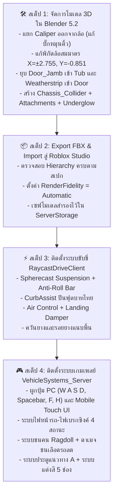

# 🏎️ FEAT-01D: Tesla Roadster Raycast Modular Pipeline (พิมพ์เขียวระบบรถยนต์ Raycast & สถาปัตยกรรมโมเดล 3D)

> **โปรเจกต์:** HOKI TOWN  
> **โมเดลเป้าหมาย:** `Workspace.TeslaRoadster` (Raycast Modular Edition)  
> **สถานะ:** ✅ ติดตั้งและทดสอบระบบ Hybrid Raycast Chassis เรียบร้อยแล้ว (Exit Code 0)  
> **ไฟล์อ้างอิงเดิม:** `2026-11-08-tesla-modular-animation-pipeline.md` (เก็บรักษาไว้เป็น Reference)  
> **วันที่บันทึก:** 2026-11-08  

---

## 🎯 1. บทสรุปการเปลี่ยนผ่านสู่ระบบ Raycast (Executive Summary)

ระบบยานพาหนะของ HOKI TOWN ได้ยกเลิกข้อจำกัดของระบบ Constraint-based ดั้งเดิม (A-Chassis / Springs) และเปลี่ยนผ่านสู่ **Raycast Arcade Vehicle Architecture (สไตล์ Jailbreak / Car Dealership Tycoon)** อย่างเต็มรูปแบบ:

1. **Zero Physics Glitch (ไร้บั๊กฟิสิกส์):** ตัดปัญหาล้อติดขอบฟุตบาท, รถเหินปลิวเวลาชนเนินกระแทก, และล้อสะบัดจนหลุดออกนอกแมพ
2. **Single Physics Collider:** ทั้งคันใช้กล่อง `Chassis_Collider` เพียงชิ้นเดียวในการรับแรงชน (`CanCollide = true`) ส่วนตัวถังและล้อทั้งหมดเป็น `CanCollide = false` และ `Massless = true` ทำให้เซิร์ฟเวอร์ Roleplay รองรับรถวิ่งพร้อมกัน 30–40 คันได้ที่ 60 FPS
3. **Cosmetic Wheels & Visual Solver:** ล้อและคาลิปเปอร์เป็น Visual Mesh 100% ควบคุมตำแหน่งและองศาการหมุนรอบแกนผ่านสคริปต์ `CFrame` ทุกเฟรมอย่างแม่นยำ

---

## 🚗 ส่วนที่ 1: สถาปัตยกรรมโมเดล 3D ใน Blender 5.2 (3D Model Pipeline)

### 1.1 แผนผังโครงสร้างโมเดล (Clean Modular Hierarchy)

```text
TeslaRoadster (Model ใน Roblox)
├── Chassis_Collider (RootPart - กล่อง Collision สี่เหลี่ยมลบมุมล่างหน้าแบบสกี CanCollide = true)
├── DriveSeat (เบาะคนขับ จุดอ้างอิงและรับ Input)
│
├── Attachments (จุดอ้างอิงยิง Ray, แสงไฟ และ VFX - ฝังไว้ที่ Chassis_Collider)
│   ├── Ray_FL, FR, RL, RR       <-- จุดยิง Raycast ระบบช่วงล่าง 4 ล้อ (ระนาบซุ้มล้อบน)
│   ├── Probe_Curb_FL, FR        <-- จุดยิง Ray ดักหน้า 45° สำหรับ CurbAssist ปีนฟุตบาทไทย
│   ├── Smoke_FL, FR, RL, RR     <-- จุดปล่อยควันยางและรอยยาง แนบระนาบพื้นถนนหลังหน้ายาง
│   ├── EngineBay_VFX            <-- จุดปล่อยควันขาว / ควันดำ / ไฟลุก เวลาเลือดรถลด
│   ├── Light_Head_L, R          <-- แหล่งกำเนิด SpotLight ไฟหน้ารถส่องถนน
│   ├── Light_Tail_L, R          <-- แหล่งกำเนิด PointLight ไฟท้ายสีแดง
│   └── Underglow_Lights         <-- แหล่งกำเนิดแสง SurfaceLight ส่องพื้น 4 ทิศทาง
│
├── Body (Model ตัวถัง - CanCollide = false, Massless = true ทั้งหมด)
│   ├── Body_Primary_Paint       <-- [ช่องสี 1] ฝากระโปรง, แก้มข้าง, หลังคา, ฝาท้าย (Tintable)
│   ├── Body_Secondary_Carbon    <-- ลิ้นหน้า, สเกิร์ตข้าง, ดิฟฟิวเซอร์ท้าย (คาร์บอนดำด้าน ไม่เปลี่ยนสี)
│   ├── Body_Glass               <-- กระจกบังลมหน้า และหลังคาพาโนรามาแก้ว (Transparency = 0.6)
│   ├── Body_Interior_Tub        <-- โครงห้องโดยสาร + ผนังซุ้มประตู Door_Jamb (ยุบรวมประหยัด 2 Draw Calls)
│   ├── Body_Interior_Seats      <-- [ช่องสี 2] เบาะหนังคู่หน้า (Grayscale PBR Tintable)
│   ├── Body_Interior_Console    <-- [ช่องสี 3] แผงคอนโซลและแดชบอร์ด
│   ├── Steering_Wheel           <-- พวงมาลัย (Origin ที่คอพวงมาลัย หมุนตามมุมเลี้ยว Steer)
│   ├── Center_Screen            <-- จอดิจิทัลกลางรถ รองรับ SurfaceGui ซิงค์ความเร็ว 60 FPS
│   ├── Plate_Rear               <-- แผ่นป้ายทะเบียนหลัง ซิงค์รหัสเมือง HOKI TOWN
│   ├── Underglow_Neon_Bars      <-- แถบนีออน 4 เส้นใต้ท้องรถ (Material.Neon)
│   ├── Lights_Headlight_Bulbs   <-- เลนส์โคมไฟหน้า (สลับ Neon ขาว / พลาสติกใส)
│   ├── Lights_Taillight_Bar     <-- เส้นแถบไฟท้าย LED ทรงโค้ง (สลับไฟหรี่ / ไฟเบรกแดงจ้า)
│   │
│   ├── Door_FL (บานประตูซ้าย)    <-- Origin อยู่ที่แกนเสา A-Pillar (หมุนเปิด 45°)
│   │   ├── Outer_Skin_FL        <-- เปลือกนอกสีเดียวกับ Body_Paint
│   │   ├── Inner_Card_FL        <-- แผงใน + ขอบยาง Weatherstrip (ยุบรวมประหยัด 2 Draw Calls)
│   │   └── Window_FL            <-- กระจกไร้กรอบบานซ้าย (เลื่อนขึ้น-ลงได้)
│   │
│   └── Door_FR (บานประตูขวา)    <-- โครงสร้างตัน 3 ชั้นแบบเดียวกับ Door_FL
│
└── Wheels & Brakes (CanCollide = false, Massless = true, Cosmetic Only)
    ├── Calipers (คาลิปเปอร์เบรก - แยกชิ้นไม่ให้หมุนติ้วตามล้อ!)
    │   ├── Caliper_FL           <-- [ช่องสี 5] คาลิปเปอร์หน้าซ้าย (ขยับตามโช้ค + มุมเลี้ยว Yaw)
    │   ├── Caliper_FR           <-- [ช่องสี 5] คาลิปเปอร์หน้าขวา
    │   ├── Caliper_RL           <-- [ช่องสี 5] คาลิปเปอร์หลังซ้าย (ขยับตามโช้คอย่างเดียว)
    │   └── Caliper_RR           <-- [ช่องสี 5] คาลิปเปอร์หลังขวา
    │
    └── Wheel_Meshes (ล้อแม็กซ์ + ยาง - หมุนรอบแกน Pitch ตามความเร็วรถ)
        ├── Wheel_FL: พิกัดกึ่งกลาง (-2.755, -0.851, -4.662), Origin กลางดุมล้อ
        │   └── Rim [ช่องสี 4] + Tire ยางดำ
        ├── Wheel_FR: พิกัดกึ่งกลาง ( 2.755, -0.851, -4.662), Origin กลางดุมล้อ
        ├── Wheel_RL: พิกัดกึ่งกลาง (-2.755, -0.851,  5.008), Origin กลางดุมล้อ
        └── Wheel_RR: พิกัดกึ่งกลาง ( 2.755, -0.851,  5.008), Origin กลางดุมล้อ
```

---

### 1.2 การแก้ไขและควบคุมสเปกทางวิศวกรรม (Engineering Fixes)

1. **แก้พิกัดล้อให้สมมาตร 100% (Symmetric Wheel Offsets):**
   * **แกน X (ซ้าย-ขวา):** ปรับเป็น $\pm 2.755\text{ studs}$ เท่ากันทั้งสองฝั่ง (ลบความเหลื่อม $0.024\text{ studs}$ ทิ้ง)
   * **แกน Y (ความสูงล้อขนานระนาบถนน):** ปรับทุกล้อเท่ากันที่ $Y = -0.851\text{ studs}$ (ดึงล้อหลังซ้าย RL ที่ลอย $-0.792$ ลงมาที่ $-0.851$ ให้ระนาบสปริงไม่เบี้ยว)
   * **แกน Z:** ล้อหน้าคู่ $Z = -4.662$, ล้อหลังคู่ $Z = +5.008$
2. **แก้บั๊ก "คาลิปเปอร์หมุนติ้วตามล้อ (Caliper Spin Bug)":**
   * ผ่าแยก `Caliper_FL..RR` (58 โพลีกอนต่อข้าง) ออกมาจากตัวล้อ
   * ในสคริปต์ CFrame:
     * ล้อแม็กซ์ + ยาง (`Wheel_Mesh`): รับทั้ง `SteerAngle` + `SpinAngle` (หมุนตามความเร็ว)
     * คาลิปเปอร์ (`Caliper`): รับเฉพาะ `SuspensionOffset` + `SteerAngle` (อยู่นิ่ง ไม่หมุนตามแกน Pitch)
3. **การยุบ Mesh ลด Draw Calls (ประหยัด 4 ชิ้นต่อคันฟรีๆ):**
   * รวม `Door_Jamb_FL` และ `_FR` (ผนังซุ้มประตู) เข้ากับ `Body_Interior_Tub` (ลด 2 ชิ้น)
   * รวม `Weatherstrip` (ขอบยาง) เข้ากับ `Inner_Card` ของประตู (ลด 2 ชิ้น)
4. **การคุม Polycount และ VRAM:**
   * โพลีกอนทั้งคันรวม: **~11,258 Polygons (~22,500 Tris)** $\ll$ โควตา 35,000–50,000 Tris
   * RenderFidelity: ตั้งเป็น `Automatic` รองรับ LOD ระยะไกล 200+ studs
   * PBR Textures: ควบคุมไม่เกิน $1024 \times 1024$ px และใช้ Shared Asset IDs

---

## 💻 ส่วนที่ 2: สถาปัตยกรรมสคริปต์ (Raycast Engine & Gameplay Logic)

### 2.1 ผังการควบคุม (Input Scheme)

#### 💻 บนคอมพิวเตอร์ (PC Controls):
* **`W`:** เดินหน้า (Forward / Throttle)
* **`S`:** ถอยหลัง (Reverse) / เบรกชะลอเมื่อรถกำลังวิ่งเดินหน้า
* **`A` / `D`:** เลี้ยวซ้าย-ขวา (Steering)
* **`Spacebar`:** เบรกมือ/เบรกหยุดรถสนิท (ดักด้วย `ContextActionService` Sink ไม่ให้ตัวละครกระเด้งหลุด)
* **`F`:** **ลงจากรถ (Exit Vehicle)**
* **`H`:** **เปิด-ปิดไฟหน้ารถ (Headlights Toggle)**

#### 📱 บนโทรศัพท์มือถือ (Mobile Controls):
* **ปุ่มบังคับ 4 ปุ่มหลัก (ไม่มีปุ่มเบรกแยก):**
  1. ปุ่มเดินหน้า (Forward)
  2. ปุ่มถอยหลัง / เบรก (`S`)
  3. ปุ่มเลี้ยวซ้าย (Left)
  4. ปุ่มเลี้ยวขวา (Right)
* **ปุ่มฟังก์ชันพิเศษ:**
  * ปุ่ม **`[🚪 ลงจากรถ]`** ที่มุมบนซ้าย ปลอดภัยจากการกดโดนโดยบังเอิญ
  * ปุ่ม **`[💡]`** สำหรับสลับเปิด-ปิดไฟหน้ารถ

---

### 2.2 สคริปต์ขับขี่ฝั่งไคลเอนต์ (`RaycastDriveClient` - 60 FPS)

1. **ระบบช่วงล่าง Spherecast (Suspension Solver):**
   * ยิง `workspace:Shapecast` (Spherecast ขนาดหน้ายาง) ลงพื้นจาก `Ray_FL..RR`
   * คำนวณแรงสปริงและโช้คอัพ: $F_s = k \cdot (\text{RestLength} - \text{RayDist}) - c \cdot v_{\text{rel}}$
   * คำนวณกันโคลง (Anti-Roll Bar): ถ่ายแรงกดข้ามฝั่งซ้าย-ขวา ป้องกันรถพลิกคว่ำขณะเข้าโค้งแรง
2. **ระบบข้ามฟุตบาทไทย (`CurbAssist`):**
   * ยิง Probe Ray เฉียง $45^\circ$ หน้าล้อคู่หน้า
   * เมื่อพบขอบสันปูนความสูง $\le 2.1\text{ studs}$: เพิ่มแรงยก `VectorForce` ยกระนาบหน้ารถขึ้นล่วงหน้า รถปีนข้ามฟุตบาทได้อย่างนุ่มนวล ไม่สะดุดหัวทิ่ม
3. **ระบบลอยฟ้าและลงจอด (Air Control & Landing Damper):**
   * เมื่อลอยพ้นพื้น (Air Time): แรงสปริงเป็น $0$
   * เปิดระบบ **Air Pitch & Roll:** กด `W/S` คุมก้ม-เงย, `A/D` คุมเอียงซ้าย-ขวา เพื่อแต่งท่าลงพื้น
   * **Landing Damper:** เมื่อแตะพื้นหลังกระโดด เพิ่มค่า Damper $c$ ชั่วคราว $0.2\text{s}$ ซับแรงกระแทก รถดูดติดถนน ไม่กระดอนปลิว
4. **ระบบดริฟต์ ควันยาง และรอยยาง (Drift VFX):**
   * เช็กความเร็วไถลออกข้าง: `if math.abs(lateralVelocity) > DRIFT_THRESHOLD`
   * เปิด `ParticleEmitter` ปล่อยควันยางที่ `Smoke_FL..RR` เปลี่ยนสีตาม `raycastResult.Material` (ยางมะตอย = ขาว, หญ้า/ดิน = ฝุ่นน้ำตาล)
   * สั่งเปิด `Trail` หรือ Stamp Decal รอยยางแนบระนาบผิวถนนตาม `raycastResult.Normal`

---

### 2.3 สคริปต์เซิร์ฟเวอร์และเกมเพลย์ (`VehicleSystems_Server`)

1. **ระบบไฟรถยนต์สมจริง 4 สถานะ (Headlights & Taillights Sync):**
   * **สถานะ 1 (ปิดไฟ + ไม่เบรก):** ไฟหน้าและไฟท้ายดับสนิท
   * **สถานะ 2 (เปิดไฟ `H` + ไม่เบรก):** ไฟหน้าสว่างขาว (`Neon` + `SpotLight`) และไฟท้ายติดเป็น **ไฟหรี่สีแดงนุ่มนวล (Dim Red)**
   * **สถานะ 3 (เหยียบเบรก `Spacebar` หรือ `S` ตอนปิดไฟ):** ไฟท้ายติดสว่างเป็น **ไฟเบรกสีแดงจ้า 100% (Intense Red Neon)** พร้อมแสงสีแดงสะท้อนท้ายรถ
   * **สถานะ 4 (เหยียบเบรกตอนเปิดไฟ `H`):** ไฟท้ายเร่งความสว่างจากไฟหรี่ $\rightarrow$ ไฟเบรกสีแดงจ้าทันที
2. **ระบบการชนคนเดินถนน (Pedestrian Ragdoll & Damage):**
   * ตรวจจับแรงปะทะกับตัวละครที่มี `Humanoid` ด้วยความเร็ว $> 15\text{ studs/s}$:
   * สั่งตัดการทรงตัวเข้าสู่สถานะ **Ragdoll (ตัวละครลอยกระเด็นตามแรงส่ง)**
   * หักเลือดคนเดินถนน: `Humanoid:TakeDamage(Speed * 1.5)`
3. **ระบบการชนสิ่งกีดขวางและเลือดรถลด (Crash Damage):**
   * ตรวจจับแรงชนผ่านเซนเซอร์ 5 สปีด (12 ถึง 85 studs/s) หักค่า Attribute `Health`
   * **เอฟเฟกต์เครื่องพัง (`EngineBay_VFX`):**
     * `Health < 50%`: ควันขาวเตือน (`WarningWhiteSmoke`)
     * `Health < 25%`: ควันดำหนาทึบ (`HeavyBlackSmoke`)
     * `Health = 0%`: ไฟลุกท่วม (`EngineFire`) + สั่งตัดกำลังเครื่องยนต์ (`VehiclePowerDisabled = true`)
     * ซ่อมด่วน: กด `[R]` ส่ง RemoteEvent ฟื้นฟูเลือดและน้ำมัน 100%
4. **ระบบประตู "แนวทาง A" (Instant Sit + ประตูสวิงรับ 0.4s + โหมด Car Meet):**
   * **ขึ้นรถ:** ผู้เล่นกด Prompt ขึ้นรถ $\rightarrow$ วาปเข้านั่งที่ `DriveSeat` ทันที (ไร้บั๊กตัวละคร, ไม่หน่วงจังหวะหนีตาย) แต่ในเสี้ยววินาทีเดียวกัน `Door_FL` จะสวิงเปิด $45^\circ$ แล้วดึงกระแทกปิดกลับเข้ามาพร้อมเสียง "ปึ้ก!" (0.4 วินาที)
   * **ลงรถ:** ผู้เล่นกด `F` (หรือปุ่มลงรถบนมือถือ) $\rightarrow$ ประตูสวิงเปิด ตัวละครก้าวออกมายืนข้างประตูอย่างปลอดภัย แล้วประตูปิด
   * **โหมดโชว์รถ (Car Meet Mode):** มีปุ่มกดค้างเปิดประตูทั้งสองบานเพื่อโชว์ดีเทลห้องโดยสารและเบาะหนัง
5. **ระบบแต่งสี 5 ช่อง & ไฟนีออนใต้ท้องรถ (Customization):**
   * ช่อง 1: `Body_Primary_Paint.Color = Color3` (สีตัวถัง)
   * ช่อง 2: `Body_Interior_Seats.Color = Color3` (สีเบาะหนังย้อมทับ PBR Grayscale)
   * ช่อง 3: `Body_Interior_Console.Color = Color3` (สีคอนโซล)
   * ช่อง 4: `Rim.Color = Color3` (สีล้อแม็กซ์)
   * ช่อง 5: `Caliper_FL..RR.Color = Color3` (สีคาลิปเปอร์เบรก)
   * **ไฟใต้รถ:** สลับเปิด-ปิด และเปลี่ยนสี `Underglow_Neon_Bars` พร้อมอัปเดตสีของ `SurfaceLight` สะท้อนผิวถนน

---

## 📌 แผนงานดำเนินการ (Action Steps)


