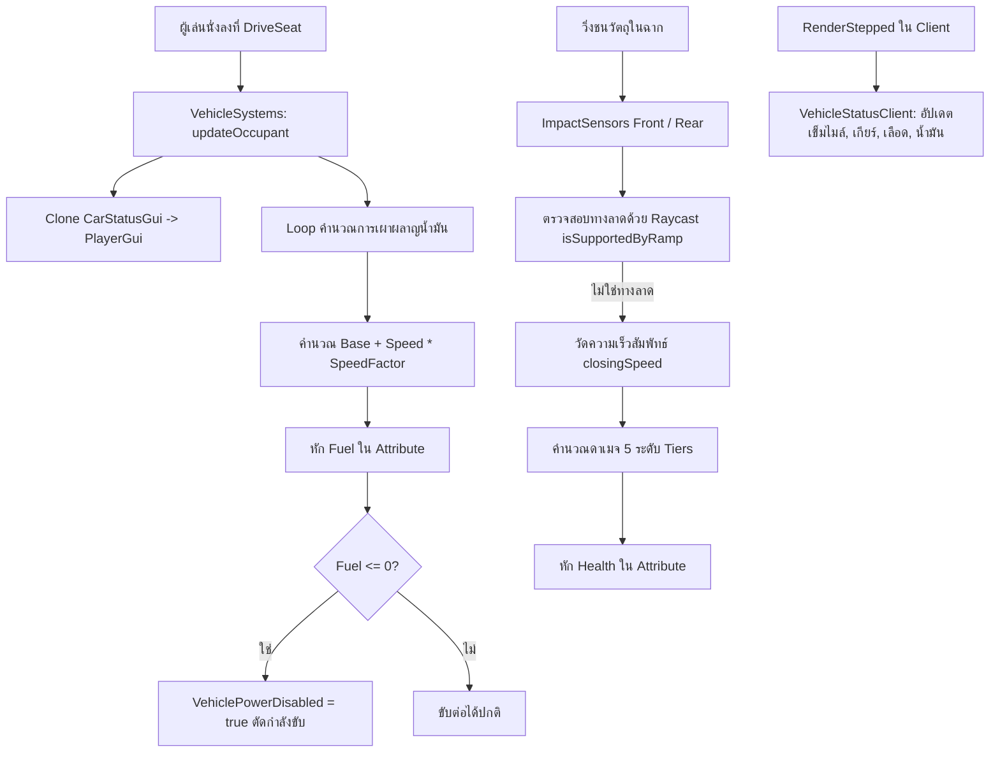

# 🚗 FEAT-01: Vehicle Systems & A-Chassis (ระบบยานพาหนะและการขับขี่)

> **ตำแหน่งใน DataModel:** `Workspace.TeslaRoadster`  
> **สคริปต์หลัก:** 
> - เซิร์ฟเวอร์: `Workspace.TeslaRoadster.VehicleSystems` (284 บรรทัด)
> - ไคลเอนต์: `Workspace.TeslaRoadster.CarStatusGui.VehicleStatusClient` (95 บรรทัด)
> - เฟรมเวิร์กฐาน: `A-Chassis Tune 6.8+`

---

## 1. ภาพรวมสถาปัตยกรรมตัวรถ (Car Architecture)
ตัวรถใน HOKI TOWN ใช้โมเดล **Tesla Roadster** ที่ขับเคลื่อนด้วย **A-Chassis 6.8+** แต่ผู้พัฒนาก่อนหน้าได้พัฒนาเลเยอร์ระบบเฉพาะตัว (`VehicleSystems`) ครอบทับลงไป เพื่อสร้างกลไกการเล่นแบบเกมแนว Roleplay/Survival ที่มีทั้งความเสียหายจากการชนและการสิ้นเปลืองน้ำมัน

---

## 2. ระบบคำนวณดาเมจการชน 5 ระดับ (5-Tier Crash Damage System)
ใน `VehicleSystems` มีการฝัง Attributes ไว้ที่ตัวโมเดลรถ เพื่อให้ Game Designer สามารถปรับแต่งความแรงและดาเมจของการชนได้โดยไม่ต้องแก้โค้ด:

| ระดับ (Tier) | ชื่อ Attribute ความเร็ว | ค่า Default (studs/s) | ชื่อ Attribute ดาเมจ | ค่าดาเมจที่หัก |
| :---: | :--- | :---: | :--- | :---: |
| **ระดับ 1** | `ImpactSpeed1` | **12** | `ImpactDamage1` | **2** |
| **ระดับ 2** | `ImpactSpeed2` | **25** | `ImpactDamage2` | **5** |
| **ระดับ 3** | `ImpactSpeed3` | **40** | `ImpactDamage3` | **12** |
| **ระดับ 4** | `ImpactSpeed4` | **60** | `ImpactDamage4` | **22** |
| **ระดับ 5** | `ImpactSpeed5` | **85** | `ImpactDamage5` | **35** |

### อัลกอริทึมการคำนวณ (Interpolation Formula):
เมื่อความเร็วของการชน ($v$) อยู่ระหว่างสอง Tier โค้ดจะใช้ Linear Interpolation (Lerp) อย่างราบรื่น:
$$\alpha = \text{clamp}\left(\frac{v - v_{\text{lower}}}{v_{\text{upper}} - v_{\text{lower}}}, 0, 1\right)$$
$$\text{Damage} = d_{\text{lower}} + (d_{\text{upper}} - d_{\text{lower}}) \times \alpha$$

### การป้องกันการเกิดดาเมจปลอม (Anti-False Collision Filter):
1. **คูลดาวน์การชน (`IMPACT_COOLDOWN = 0.65s`):** ป้องกันไม่ให้การไถลไปตามกำแพงสร้างดาเมจรัวซ้ำซ้อน
2. **ตัวตรวจจับเฉพาะหน้าและหลัง (`ImpactSensors`):** มีเซนเซอร์ `Front` และ `Rear` เท่านั้นที่จะคำนวณดาเมจ โดยวัดเวกเตอร์ความเร็วเข้าหาทิศทางของตัวรถ (`sensorDirection:Dot(relativeVelocity)`)
3. **การตัดทางลาด (`isSupportedByRamp`):** ใช้ `workspace:Raycast` ยิงลงจากล้อทั้ง 4 ล้อ หาก Normal ของพื้นมีความลาดเอียง ($0.05 < \text{Normal.Y} < 0.995$) และรถกำลังวิ่งขึ้นเนิน โค้ดจะไม่นับเป็นการชนกำแพง

---

## 3. ระบบการสิ้นเปลืองน้ำมันและการตัดกำลัง (Fuel Drain & Engine Cutoff)
- **ความจุสูงสุด:** `MaxFuel = 100` (Attribute)
- **เงื่อนไขการเผาผลาญ:** จะลดลงเฉพาะเมื่อมีผู้เล่นนั่งที่ `DriveSeat` และรถมีความเร็วมากกว่า `FuelDrainStartSpeed` ($4\text{ studs/s}$)
- **สูตรคำนวณการลดของน้ำมันต่อวินาที:**
  $$\text{DrainRate} = \text{FuelDrainBasePerSecond} + (\text{Speed} \times \text{FuelDrainPerStudPerSecond})$$
  *(Default: $0.01 + \text{Speed} \times 0.0002$ หน่วยต่อวินาที)*
- **การตัดกำลังเครื่องยนต์:**
  เมื่อน้ำมันปัดเศษลงเหลือ $0\%$ สคริปต์จะเซ็ต `VehiclePowerDisabled = true` ทำให้รถหยุดขับเคลื่อนทันที จนกว่าจะได้รับการเติมน้ำมัน

---

## 4. หน้าปัดมาตรวัดในรถ (`CarStatusGui`)
หน้าปัด GUI ถูกเก็บไว้ในโมเดลรถ และจะถูกโคลนไปยัง `PlayerGui` ของผู้เล่นเมื่อขึ้นนั่งขับ โดยมีการซิงค์ข้อมูลผ่าน `RunService.RenderStepped`:
- **SpeedNow (ความเร็ว):** แปลงจากความเร็วในเกม (studs/s) เป็น **กิโลเมตรต่อชั่วโมง (KM/H)**:
  $$\text{Speed}_{\text{km/h}} = \text{AssemblyLinearVelocity.Magnitude} \times 1.008$$
  จัดฟอร์แมตตัวเลข 3 หลักเสมอ (เช่น `045`, `120`)
- **เกียร์ (Gear Display):**
  - $\le -2 \rightarrow \mathbf{P}$ (Parking)
  - $-1 \rightarrow \mathbf{R}$ (Reverse)
  - $0 \rightarrow \mathbf{N}$ (Neutral)
  - $1 \text{ ถึง } 6 \rightarrow \mathbf{1 - 6}$
  - แสดงผลพร้อมกันทั้งเกียร์ปัจจุบัน (`GearNow`), เกียร์ถัดไป (`GearNext`), และเกียร์ก่อนหน้า (`GearBefore`)
- **HealthPercent & FuelPercent:** แสดงผลเปอร์เซ็นต์เลือดและน้ำมันแบบไดนามิก

---

## 5. การปรับแต่งความสวยงามทางเทคนิค (Visual Polish)
- **การซ่อนสปริงโช้ค (`hideShockVisual`):** 
  โค้ดใน `VehicleSystems` ทำการวนลูปหา `SpringConstraint` และชิ้นส่วนที่มีชื่อคำว่า `shock`, `spring`, `damper`, `coil` แล้วปรับ `Transparency = 1` และ `Visible = false` อัตโนมัติ เพื่อไม่ให้ก้านสปริงของ A-Chassis โผล่ออกมาขัดตาในมุมมองภายนอก โดยที่ยังคงคุณสมบัติทางฟิสิกส์ไว้ $100\%$

---

## 💡 คำแนะนำสำหรับการทำต่อ (Handover Directives)
1. **ย้ายรถออกจาก Workspace ไปไว้ใน ServerStorage:**
   ปัจจุบันรถถูกวางค้างไว้ 2 คันในฉาก ควรเปลี่ยนไปใช้ระบบ **Vehicle Spawner** ที่กดเบิกผ่านจุด `Summon_Car`
2. **เชื่อมต่อจุดเติมน้ำมัน:**
   นำ Attribute `Fuel` ไปผูกกับจุด `GasTankSites` เมื่อรถจอดเทียบและดับเครื่อง ให้แสดง Prompt เติมน้ำมัน
