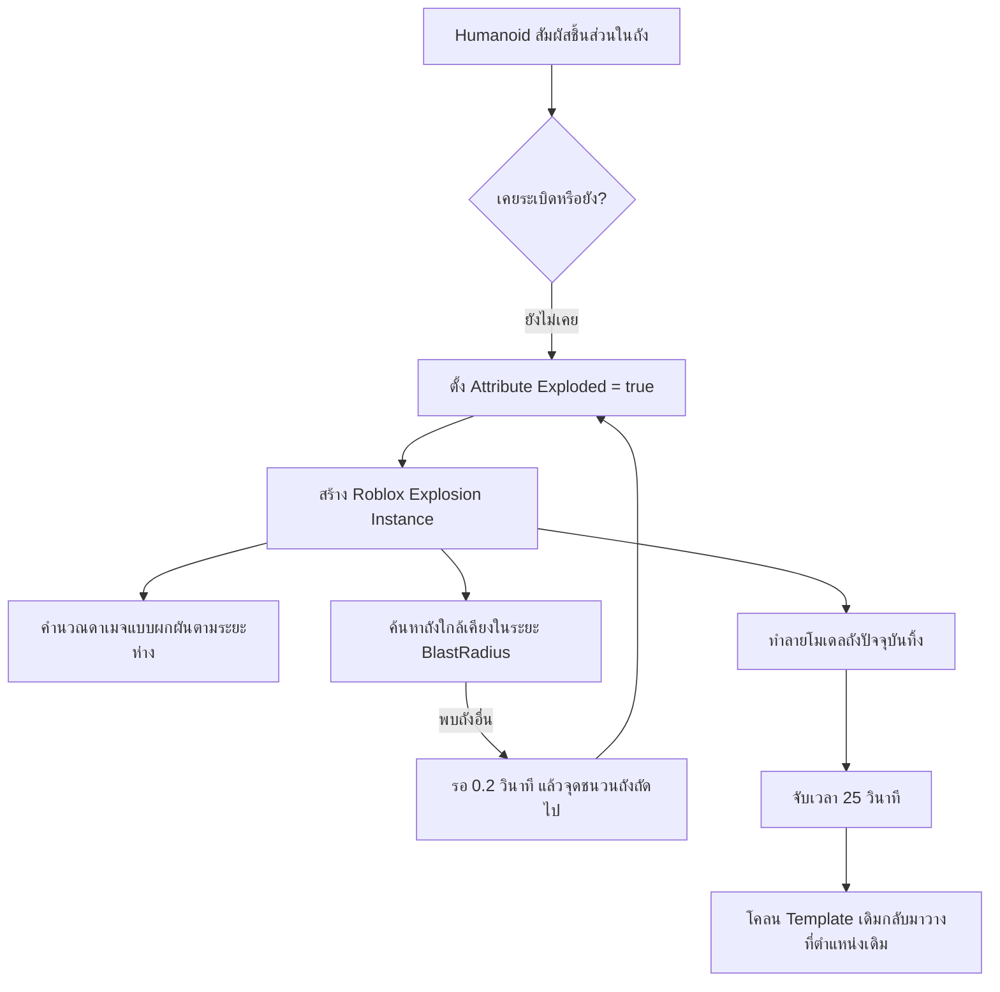

# 💥 FEAT-02: Explosive Hazards (ระบบถังระเบิดในฉาก)

> **ตำแหน่งใน DataModel:** `Workspace.ExplosiveBarrels`  
> **สคริปต์หลัก:** `Workspace.ExplosiveBarrels.BarrelExplosions` (58 บรรทัด)  
> **โมเดลในฉาก:** `ExplosiveBarrel` (จำนวน 10 ถัง)

---

## 1. ภาพรวมระบบ (System Overview)
ระบบถังระเบิดเป็นกลไกสร้างอุปสรรคและอันตรายในฉาก (Environmental Hazard) ออกแบบมาเพื่อให้ผู้เล่นหรือยานพาหนะที่สัมผัสถูกถังได้รับความเสียหาย และยังสามารถสร้างเอฟเฟกต์การระเบิดแบบโดมิโน (Chain Reaction) ได้

---

## 2. โครงสร้างชิ้นส่วนของโมเดล (`ExplosiveBarrel`)
แต่ละถังประกอบด้วยชิ้นส่วนละเอียด 8 ชิ้น:
- `Body` (Part) — ทำหน้าที่เป็น **PrimaryPart** สำหรับระบุพิกัด
- `RimTop` & `RimBottom` (Part) — ขอบบน-ล่าง
- `Band` & `Band2` (Part) — สายรัดโลหะรอบถัง
- `Rib` (Part) — ซี่โครงเสริมความแข็งแรง
- `Lid` (Part) — ฝาปิดถัง
- `Warning` (Part) — สติกเกอร์/ป้ายเตือนวัตถุอันตราย

---

## 3. พารามิเตอร์และการคำนวณฟิสิกส์ (Physics & Damage Formulas)

| พารามิเตอร์ | ค่า Default | คำอธิบาย |
| :--- | :---: | :--- |
| **รัศมีการระเบิด (`BlastRadius`)** | `14 studs` | ขอบเขตที่คลื่นระเบิดจะแผ่ไปถึง |
| **ดาเมจสูงสุด (`Damage`)** | `80 HP` | ดาเมจที่จุดศูนย์กลางระเบิด |
| **แรงผลักฟิสิกส์ (`BlastPressure`)** | `120,000` | แรงผลักชิ้นส่วนและตัวละครให้กระเด็น |
| **ระยะเวลารอสปอว์นใหม่ (`RESPAWN`)** | `25 วินาที` | เวลาหน่วงก่อนถังจะเกิดใหม่ |
| **การทำลายข้อต่อ (`DestroyJointRadiusPercent`)** | `0` | ปิดไม่ให้ทำลายข้อต่อของโมเดลอื่นรอบข้าง |
| **ประเภทการระเบิด (`ExplosionType`)** | `NoCraters` | ไม่เจาะพื้นผิว Terrain ให้เป็นหลุม |

### สูตรคำนวณดาเมจ (Distance Attenuation Formula):
เมื่อคลื่นระเบิดไปกระทบชิ้นส่วนของตัวละคร ดาเมจจะลดทอนลงตามระยะห่างจริง:
$$\text{DamageDealt} = \text{Damage} \times \left(1 - \text{clamp}\left(\frac{\text{Distance}}{\text{BlastRadius}}, 0, 1\right)\right)$$
- **ยืนติดถัง (ระยะ 0):** โดนดาเมจเต็ม $80\text{ HP}$ (เลือดเกือบหมดหลอด)
- **ยืนกึ่งกลาง (ระยะ 7 studs):** โดนดาเมจ $40\text{ HP}$
- **ยืนที่ขอบ (ระยะ 14 studs):** โดนดาเมจ $0\text{ HP}$

---

## 4. ระบบลูกโซ่และการเกิดใหม่ (Chain Reaction & Respawn Lifecycle)
1. **การหน่วงเวลาระเบิดลูกโซ่:**
   เมื่อ `ex.Hit` ชนเข้ากับโมเดลที่มีชื่อว่า `ExplosiveBarrel` ที่ยังไม่เคยระเบิด โค้ดจะเรียก `task.delay(0.2, explode, parent)` เพื่อให้เกิดจังหวะระเบิดไล่ตามลำดับ 0.2 วินาที ซึ่งให้ฟีลลิ่งภาพยนตร์แอ็กชัน
2. **การสำรองแม่แบบ (Template Caching):**
   ในขั้นตอน `setup(model)` โค้ดจะทำ `templates[model] = model:Clone()` เก็บไว้ในหน่วยความจำเซิร์ฟเวอร์ เมื่อถังถูกระเบิดและทำลายทิ้ง (`Destroy`) ตัวแปร Template จะรอคูลดาวน์ 25 วินาที แล้ว Parent กลับมาที่โฟลเดอร์ `ExplosiveBarrels` และผูก Event สัมผัสใหม่อัตโนมัติ

---

## 💡 คำแนะนำสำหรับการทำต่อ (Handover Directives)
- **เพิ่มการตรวจจับการชนของรถยนต์ (Vehicle Impact Trigger):**
  ปัจจุบันการระเบิดผูกไว้กับ `Humanoid` เท่านั้น ถ้ารถยนต์พุ่งชนโดยที่คนขับไม่ออกมาสัมผัสถังตรงๆ ถังจะไม่ระเบิด ควรเพิ่มเงื่อนไข `hit:IsDescendantOfClass("VehicleSeat")` หรือเช็คว่ารถวิ่งชนด้วยความเร็วสูงเพื่อจุดระเบิดด้วย
