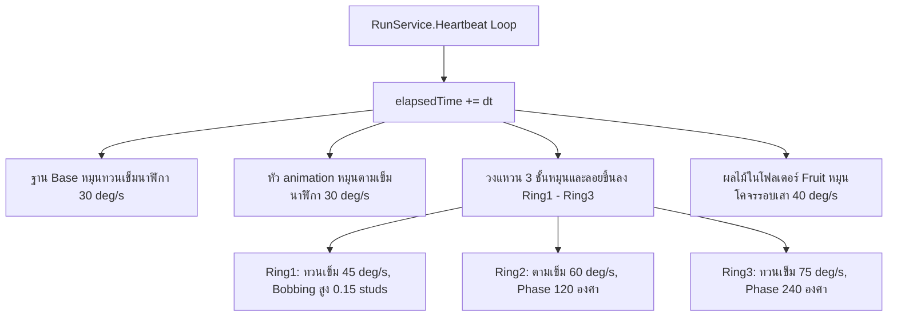

# 🌾 FEAT-03: Totem Farming System (ระบบแท่นฟาร์มและจุดเก็บเกี่ยว)

> **ตำแหน่งใน DataModel:** `Workspace.TotemFarm_Pack`  
> **สคริปต์หลัก:** `Workspace.TotemFarm_Pack.TotemAnimation` (97 บรรทัด)  
> **จุดฟาร์มที่ติดตั้งไว้แล้ว:**
> - `FarmLungA` (จุดฟาร์มลุงเอ / รวมพืชผล)
> - `FarmBanana` (จุดฟาร์มกล้วย)
> - `FarmMelon` (จุดฟาร์มเมล่อน)
> - โมเดลฟาร์มสำรอง (องุ่น / นีออน)

---

## 1. ภาพรวมระบบ (System Overview)
แท่นฟาร์มใน HOKI TOWN เป็นแลนด์มาร์กสำคัญสำหรับระบบ **Roleplay Job & Gathering Economy** โดยถูกสร้างให้เป็นเสาโทเทม 3 มิติที่มีอนิเมชั่นหมุนวนลอยตัวอย่างน่าดึงดูด (Juicy Kinematic Visuals) เพื่อให้ผู้เล่นสังเกตเห็นจุดฟาร์มได้จากระยะไกล



---

## 2. โครงสร้างชิ้นส่วนของโมเดลโทเทม (Model Hierarchy)
แต่ละแท่นฟาร์มประกอบด้วย:
- `Base` (Model/MeshPart) — ฐานรองรับแท่น
- `animation` (MeshPart) — ชิ้นส่วนหัวของโทเทม
- `Ring1`, `Ring2`, `Ring3` (MeshPart) — วงแหวนพลังงาน 3 ระดับ
- `Fruit` (Folder) — โฟลเดอร์เก็บโมเดลผลไม้ลอยได้ (กล้วย, เมล่อน, องุ่น)
- `Part` (Part) — เสากลาง

---

## 3. คณิตศาสตร์การเคลื่อนไหว CFrame (Kinematic Formulas)
สคริปต์ใช้วิธีบันทึก CFrame เริ่มต้น (`spinner.baseCFrame = part.CFrame`) แล้วคูณแปลงค่าในลูป `Heartbeat`:

### 1) การลอยขึ้นลงแบบฮาร์มอนิก (Bobbing Motion):
$$y_{\text{offset}} = \sin(\text{elapsedTime} \times \text{bobSpeed} + \text{phase}) \times \text{bobAmp}$$
- `Ring1`: $\text{bobSpeed} = 1.5$, $\text{phase} = 0$, $\text{amplitude} = 0.15\text{ studs}$
- `Ring2`: $\text{bobSpeed} = 1.5$, $\text{phase} = \frac{2\pi}{3}\ (120^\circ)$, $\text{amplitude} = 0.15\text{ studs}$
- `Ring3`: $\text{bobSpeed} = 1.5$, $\text{phase} = \frac{4\pi}{3}\ (240^\circ)$, $\text{amplitude} = 0.15\text{ studs}$
*(การปรับ Phase Shift $120^\circ$ ทำให้วงแหวนทั้ง 3 ชิ้นลอยขึ้นลงสลับจังหวะกันเป็นคลื่นอย่างสวยงาม)*

### 2) การหมุนแบบหลายทิศทาง (Multi-axis Rotation):
$$\theta = \text{rad}(\text{dir} \times \text{speed} \times \text{elapsedTime})$$
$$\text{part.CFrame} = \text{baseCFrame} \times \text{CFrame.new}(0, y_{\text{offset}}, 0) \times \text{CFrame.Angles}(0, \theta, 0)$$

---

## 4. สถานะปัจจุบัน vs สิ่งที่ต้องสร้างต่อ (Handover Gap Analysis)

| องค์ประกอบ | สภาพปัจจุบัน | สิ่งที่ต้องทำเพิ่มเพื่อให้เป็นเกม |
| :--- | :--- | :--- |
| **ภาพและการเคลื่อนไหว** | 🟢 หมุนสวยงามสมบูรณ์ $100\%$ | ย้ายลูปอนิเมชั่นไปรันฝั่ง Client เพื่อประหยัด CPU ของ Server |
| **การโต้ตอบของผู้เล่น (Interaction)**| 🔴 ยังไม่มี | ติดตั้ง `ProximityPrompt` ที่โคนเสา (เช่น กด [E] เก็บกล้วย) |
| **อนิเมชั่นตัวละคร (Character Anim)** | 🔴 ยังไม่มี | เล่นท่าก้มเก็บของ / ตัดผลไม้ เมื่อผู้เล่นกดปุ่ม |
| **ไอเทมในกระเป๋า (Inventory Item)** | 🔴 ยังไม่มี | เพิ่มไอเทม `Banana`, `Melon` เข้ากระเป๋าผู้เล่น |
| **ระบบขายผลไม้ (Selling Market)** | 🔴 ยังไม่มี | สร้าง NPC หรือจุดรับซื้อผลไม้เพื่อแปลงเป็นเงินในเกม |

---

## 💡 โค้ดตัวอย่างสำหรับการต่อยอดระบบเก็บเกี่ยว (Recommended Harvest Script)
```luau
-- ตัวอย่างการผูก ProximityPrompt เข้ากับจุดฟาร์ม
local prompt = Instance.new("ProximityPrompt")
prompt.ActionText = "เก็บเกี่ยวผลไม้"
prompt.ObjectText = totem.Name -- เช่น FarmBanana
prompt.HoldDuration = 2.0 -- ต้องกดค้าง 2 วินาที
prompt.MaxActivationDistance = 10
prompt.Parent = totem.PrimaryPart or totem:FindFirstChild("Part")

prompt.Triggered:Connect(function(player)
    -- ตรวจสอบกระเป๋า และแจกไอเทมผลไม้
    print(player.Name .. " เก็บเกี่ยว " .. totem.Name .. " สำเร็จ!")
end)
```
