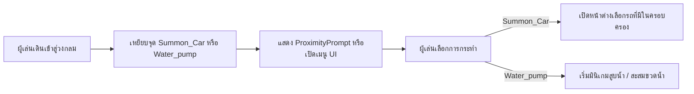

# 📍 FEAT-04: FiveM Roleplay Interaction Points (จุดอินเตอร์แอ็กชันสไตล์ FiveM GTA)

> **ตำแหน่งใน DataModel:** `Workspace.Fivem_pack_v2`  
> **โมเดลหลัก:**
> - `Summon_Car` (จุดเบิกรถ / โรงจอดรถ)
> - `Water_pump` (จุดปั๊มน้ำ / ตักน้ำ)

---

## 1. ภาพรวมระบบ (System Overview)
ใน `Workspace.Fivem_pack_v2` มีการวางโมเดลวงกลมเรืองแสงสไตล์ FiveM GTA Roleplay ซึ่งเป็นเอกลักษณ์ยอดนิยมในคอมมูนิตี้เซิร์ฟเวอร์ GTA RP ไทย วงกลมเหล่านี้สร้างจาก Mesh 31 ชิ้นที่ถูกจัดวางเป็นวงรัศมีบนพื้น มีข้อความภาษาไทยระบุว่า `ก้าวข้ามขีดจำกัด`

---

## 2. รายละเอียดของแต่ละจุด (Point Analysis)

### 1) จุดเบิกรถ (`Summon_Car`)
- **ตำแหน่ง:** ตั้งอยู่ใกล้โซนถนนหลักและโชว์รูม
- **โครงสร้าง:** มี MeshPart จำนวน 30 ชิ้น และ Part แกนกลาง 1 ชิ้น
- **จุดประสงค์การใช้งาน:** 
  ใช้เป็นจุด Spawn หรือเบิกรถของผู้เล่น (Player Garage) เมื่อผู้เล่นมาเหยียบจุดนี้ ควรเปิดเมนู GUI แสดงรายการรถยนต์ที่ซื้อไว้ แล้ว Spawn รถออกมาบนเลนถนนพร้อมหันหน้าไปตามทิศทางจราจร

### 2) จุดปั๊มน้ำ (`Water_pump`)
- **ตำแหน่ง:** วางอยู่บริเวณใกล้จุดฟาร์มและแหล่งน้ำ
- **โครงสร้าง:** มี MeshPart 22 ชิ้น และ Part 5 ชิ้น
- **จุดประสงค์การใช้งาน:**
  ใช้สำหรับอาชีพเกษตรกรรมหรือระบบความกระหายน้ำ (Thirst System) ผู้เล่นสามารถเข้ามากดสูบน้ำ เพื่อนำถังน้ำ/ขวดน้ำไปรดน้ำต้นไม้ในฟาร์ม หรือนำไปขายต่อให้กับโรงงานในเมือง

---

## 3. สภาพปัจจุบัน vs แผนการพัฒนาต่อ (Handover Directives)

| รายการ | สภาพปัจจุบัน | สิ่งที่ต้องพัฒนาเพิ่ม |
| :--- | :--- | :--- |
| **โมเดลและแสงเรือง** | 🟢 สวยงาม พร้อมระบุตำแหน่ง | จัดการ Group ชิ้นส่วนให้มี PrimaryPart ชัดเจน |
| **ระบบตรวจจับการเข้าใกล้** | 🔴 ยังไม่มีสคริปต์ | ใส่ `ZonePlus` หรือ `ProximityPrompt` ที่แกนกลาง |
| **ระบบ Garage Spawner** | 🔴 ยังไม่มี | ทำ RemoteFunction สั่ง Spawn รถจาก `ServerStorage` |
| **ระบบความจุลานจอด** | 🔴 ยังไม่มี | ตรวจสอบว่ามีรถคันอื่นขวางจุด Spawn อยู่หรือไม่ก่อนปล่อยรถ |
