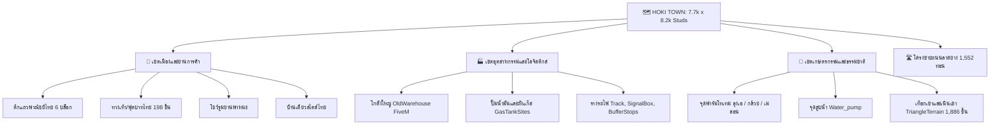

# 🗺️ FEAT-05: World Map & Environment (โครงสร้างแผนที่และสิ่งแวดล้อม)

> **ขอบเขตแผนที่ (World Bounds):** $7,722.2 \times 494.7 \times 8,248.3$ studs  
> **จุดศูนย์กลาง (Center Point):** $(-1302.7, 121.4, -190.9)$  
> **สไตล์แผนที่:** ไทยโมเดิร์นร่วมสมัย ผสมผสาน GTA Roleplay (Thai Modern Shophouse & Suburban FiveM)

---

## 1. องค์ประกอบสำคัญของแผนที่ (Key Environmental Zones)

---

## 2. รายละเอียดสถาปัตยกรรมและอาคาร (Buildings Deep Dive)

### 1) ตึกแถวพาณิชย์ไทย (`ThaiShophouse` - 6 อาคาร)
- **ประเภทอ็อบเจ็กต์:** `ProceduralModel` ผสม `Model`
- **ลักษณะเด่น:** ตึกแถวปูน 3-4 ชั้น สไตล์อาคารพาณิชย์ไทยริมถนน มีกันสาด ป้ายร้านค้า และช่องประตูกระจก เหมาะสำหรับทำเป็นร้านค้า ร้านซ่อมรถ หรือคลินิกหมอในอนาคต

### 2) โกดังสินค้า FiveM (`OldWarehouse_FiveM` - 778 ชิ้นส่วน)
- **โครงสร้างภายในครบวงจร:**
  - `Shell`, `Roof`, `Floor`: โครงสร้างหลักของอาคารโกดัง
  - `Office`: ห้องทำงานผู้จัดการโกดัง
  - `Racking` & `Cargo`: ชั้นวางของขนาดใหญ่และลังสินค้า
  - `Forklift`: โมเดลรถโฟล์กลิฟต์
  - `Lights` & `Doors`: ระบบไฟส่องสว่างและประตูบานเลื่อน
  - `Signs` & `Props`: ป้ายเตือนความปลอดภัยและถังน้ำมัน

### 3) โครงข่ายทางรถไฟ (`Track`, `SignalBox`, `BufferStops`)
- มีการวางแนวรางรถไฟ (`Track`), ป้ายสัญญาณอาณัติสัญญาณ (`SignalBox`), และแป้นปะทะปลายทาง (`BufferStops`) เตรียมไว้สำหรับระบบรถไฟขนส่งสินค้าหรือรถไฟโดยสาร

### 4) จุดปั๊มน้ำมันและถังแก๊ส (`GasTankSites` - 38 ชิ้นส่วน)
- มีแท่นเติมน้ำมัน (`Pad`), เสากั้นกันชน (`Bollard`), และแท่นจ่ายเชื้อเพลิง เตรียมไว้เชื่อมโยงกับระบบน้ำมันของรถ Tesla Roadster

---

## 3. ระบบแสงและบรรยากาศ (Lighting & Atmosphere Architecture)
การตั้งค่าใน `Lighting` ได้รับการจูนสีในสไตล์ภาพยนตร์สมจริง (Cinematic Realism):

| คุณสมบัติ (Property) | ค่าที่ตั้งไว้ | จุดประสงค์ |
| :--- | :---: | :--- |
| **ClockTime** | `12:00` (เที่ยงวัน) | ให้แสงสว่างเต็มที่ เห็นรายละเอียดของเมืองชัดเจน |
| **Brightness** | `2.74` | ความสว่างสูง คอนทราสต์ชัดเจน |
| **OutdoorAmbient** | `[158, 180, 180]` | โทนฟ้าอมเทา เลียนแบบแสงท้องฟ้าธรรมชาติ |
| **Ambient** | `[77, 94, 119]` | เงาในที่ร่มไม่มืดสนิท มีโทนน้ำเงิน Cinematic |
| **ShadowSoftness**| `0.28` | ขอบเงามีความคมชัดระดับปานกลาง |
| **ExposureCompensation** | `0.05` | ดึงไดนามิกเรนจ์ของแสงให้สว่างมีมิติ |

### เอฟเฟกต์โพสต์โปรเซสซิ่ง (Post-Processing Effects):
- **LA_Cinematic_Color (ColorCorrectionEffect):** เกรดสีโทนฟิล์ม
- **LA_Sunlit_Bloom (BloomEffect):** สร้างแสงฟุ้งเมื่อมองวัตถุสะท้อนแสงแดด
- **LA_Sun_Rays (SunRaysEffect):** ลำแสงพระอาทิตย์ส่องทะลุก้อนเมฆ
- **LA_Blue_Atmosphere (Atmosphere):** หมอกฟ้าจางๆ ในระยะไกลสร้างมิติความลึก (Depth of Field)
- **Realistic Skybox (Sky):** ท้องฟ้าความละเอียดสูงสมจริง

---

## 4. ระบบวัสดุพื้นผิว (`MaterialService`)
มีการติดตั้งชุดพื้นผิว **SteaveTech MaterialService Texture Pack V1.6** พร้อมด้วย `MaterialVariant` ปรับแต่งเฉพาะ:
- `Concrete Texture`: สำหรับพื้นถนนและฟุตบาท
- `WoodenPlanks` & `Wood`: สำหรับบ้านไม้และลังสินค้า
- `Cobblestone` & `Bricks`: สำหรับผนังตึกแถวไทย
- `Grass`: สำหรับทุ่งหญ้าและเนินเขา
- `Fabric` & `curs`: สำหรับเฟอร์นิเจอร์ภายในโกดัง
