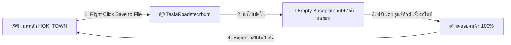

# 🏎️ คู่มือเจาะลึกระบบรถยนต์ HOKI TOWN (Vehicle Master Development Manual)

> **สำหรับ:** ผู้รับผิดชอบระบบยานพาหนะทั้งหมดของโปรเจค HOKI TOWN  
> **สถานะความปลอดภัย:** ✅ ตัวรถต้นฉบับถูกสำรองไว้ที่ `ServerStorage.GOLDEN_BACKUP_VEHICLES.TeslaRoadster_GOLDEN_ORIGINAL` เรียบร้อยแล้ว  

---

## 🛡️ 1. วิธี "ดูป" (Duplicate / Sandbox Isolation) แยกทำข้างนอกเพื่อป้องกันแมพพัง 100%

ความกังวลเรื่องการทำแมพพังเป็นเรื่องที่ถูกต้องที่สุด เพราะแมพนี้มีขนาดใหญ่ถึง $7.7k \times 8.2k$ studs มีชิ้นส่วนกว่า 35,000 ชิ้น หากทดสอบรถแล้วเกิดข้อผิดพลาด เช่น ลืม Anchor ชิ้นส่วนฉาก หรือลบโมเดลผิด จะกู้คืนยากมาก

### แนวทางการทำงานที่ปลอดภัยที่สุด (Sandbox Workflow):



### ขั้นตอนการทำ (Step-by-Step):
1. **การเซฟโมเดลรถออกไปทำข้างนอก (Export .rbxm):**
   - ในหน้าต่าง **Explorer** ของ Roblox Studio คลิกขวาที่โมเดล `TeslaRoadster`
   - เลือก **"Save to File..."** แล้วตั้งชื่อเป็น `TeslaRoadster_Dev.rbxm` เซฟไว้ในเครื่อง
2. **การเปิดลานทดสอบแยก (Baseplate Sandbox):**
   - ไปที่เมนู `File` > `New` (เปิดแมพ Baseplate โล่งๆ ใหม่เอี่ยม)
   - ลากไฟล์ `TeslaRoadster_Dev.rbxm` เข้ามาวางใน Baseplate
   - สามารถสร้างถนนทดสอบ ทางลาด โค้ง และลองขับ จูนความเร็ว แก้บั๊กได้อิสระ โดยไม่มีผลกระทบใดๆ ต่อแมพ HOKI TOWN เลย
3. **การนำกลับมาใส่แมพหลัก:**
   - เมื่อจูนรถใหม่เสร็จสิ้น ลบรถเก่าในแมพหลัก แล้วลากตัวใหม่ที่ผ่านการทดสอบเข้ามาวางแทน

---

## 🚗 2. ผ่าโครงสร้างตัวรถ Tesla Roadster (Component Breakdown)

ตัวรถ 1 คันประกอบด้วยส่วนประกอบหลัก 7 ชิ้น:

```text
TeslaRoadster (Model)
├── DriveSeat (VehicleSeat)               <-- เบาะคนขับ จุดรับ Input และวัดความเร็ว
├── A-Chassis Tune (ModuleScript)         <-- กล่องควบคุมฟิสิกส์การขับขี่หลัก (จูนที่นี่)
│   ├── A-Chassis Interface (ScreenGui)   <-- สคริปต์ขับขี่ฝั่งผู้เล่น
│   └── Plugins/                          <-- ปลั๊กอินเสริม (เสียง, แอร์โรไดนามิกส์, มาตรวัด)
├── VehicleSystems (Script)               <-- ระบบเฉพาะของ HOKI (ดาเมจชน, น้ำมัน, ตัดกำลัง)
├── CarStatusGui (ScreenGui)              <-- หน้าปัดไมล์ HUD (ความเร็ว, เกียร์, เลือด, น้ำมัน)
│   └── VehicleStatusClient (LocalScript)
├── Wheels (Model)                        <-- ล้อทั้ง 4 (FL, FR, RL, RR)
│   └── Springs / Constraints             <-- ระบบช่วงล่าง (ซ่อนสปริงตาเปล่าให้อัตโนมัติ)
├── Body (Model)                          <-- บอดี้ตัวถัง
│   ├── ImpactSensors (Model)             <-- เซนเซอร์ Front / Rear สำหรับวัดแรงชน
│   ├── Aerodynamics (Model)              <-- ปีกดักลมคำนวณ Downforce
│   └── Sounds (Model)                    <-- ซาวด์เอฟเฟกต์ (เสียงสตาร์ท, เทอร์โบ, ท่อไอเสีย)
└── Misc (Model)                          <-- ชิ้นส่วนตกแต่งและข้อต่อเชื่อม
```

---

## ⚙️ 3. กล่องควบคุมการจูนฟิสิกส์รถ (A-Chassis Config Guide)

ผู้พัฒนาก่อนหน้าได้จัดทำบล็อก `Config` ภาษาไทยไว้ที่ด้านบนสุดของสคริปต์ `A-Chassis Tune` ในบรรทัดที่ 16–60 ทำให้คุณสามารถปรับจูนบุคลิกรถได้ง่ายๆ ที่จุดเดียว:

```luau
local Config = {
	-- ความเร็ว
	TopSpeed         = 130,       -- ความเร็วสูงสุด (km/h) ถ้าใส่ 0 จะไม่จำกัด
	FinalDrive       = 3.5,       -- อัตราทดเฟืองท้าย (ค่ายิ่งเยอะ อัตราเร่งยิ่งจัด แต่ปลายจะตัน)

	-- อัตราเร่ง
	Acceleration     = 5,         -- ค่าความแรงของอัตราเร่ง
	ThrottleResponse = 0.3,       -- ความไวของคันเร่ง (0.3 = แตะแล้วพุ่งทันที)

	-- วงเลี้ยว / พวงมาลัย
	MaxSteerAngle    = 36,        -- องศาเลี้ยวล้อหน้า (36 = เลี้ยวโค้งแคบในเมืองได้ง่าย)
	SteerSpeed       = 1.0,       -- ความไวในการหักพวงมาลัย
	ReturnSpeed      = 1.5,       -- ความเร็วในการคืนพวงมาลัยตรง
	SteerAtTopSpeed  = 55,        -- เปอร์เซ็นต์มุมเลี้ยวที่ความเร็วสูงสุด (กันรถหมุนคว่ำ)
	SteerDecaySpeed  = 130,       -- ความเร็วที่เริ่มลดองศาการเลี้ยว

	-- ระบบข้ามขอบฟุตบาท (CurbAssist - ฟีเจอร์พิเศษแก้ปัญหารถสะดุดฟุตบาทไทย!)
	CurbAssistEnabled              = true,
	CurbAssistMaxStep              = 2.1,   -- ความสูงขอบฟุตบาทสูงสุดที่จะช่วยข้ามได้ (studs)
	CurbAssistAcceleration         = 240,   -- แรงยกเบาๆ ให้ล้อหน้าข้ามสันปูน
	CurbAssistAngularDampingRate   = 4,     -- ดึงเสถียรภาพไม่ให้รถพลิกคว่ำเวลาล้อปีนฟุตบาท

	-- แรงกดอากาศ (Downforce)
	DownforceFrontKgf = 40,       -- แรงกดล้อหน้าตอนวิ่ง 200 km/h (เกาะถนนขึ้น)
	DownforceRearKgf  = 50,       -- แรงกดล้อหลัง

	-- ระบบเบรก
	BrakeForce       = 4500,      -- กำลังเบรก (4500 kgf = เบรกอยู่หมัด ระยะเบรกสั้น)
}
```

---

## 💥 4. ระบบเกมเพลย์เฉพาะของ HOKI (`VehicleSystems`)

โค้ดในส่วนนี้จัดการกลไกเกม 2 อย่างหลัก:

### 1) ระบบดาเมจการชน 5 สปีด (5-Tier Crash Damage)
- ปรับแต่งได้จากหน้าต่าง **Properties > Attributes** ของโมเดล `TeslaRoadster`:
  - `ImpactSpeed1 = 12` $\rightarrow$ ชนเบาๆ โดนดาเมจ `ImpactDamage1 = 2`
  - `ImpactSpeed2 = 25` $\rightarrow$ ชนปานกลาง โดนดาเมจ `ImpactDamage2 = 5`
  - `ImpactSpeed3 = 40` $\rightarrow$ ชนเร็ว โดนดาเมจ `ImpactDamage3 = 12`
  - `ImpactSpeed4 = 60` $\rightarrow$ ชนแรง โดนดาเมจ `ImpactDamage4 = 22`
  - `ImpactSpeed5 = 85` $\rightarrow$ ชนเต็มสปีด โดนดาเมจ `ImpactDamage5 = 35`
- **ระบบกันดาเมจหลอก (`isSupportedByRamp`):** ถ้ารถกำลังปีนทางลาดชัน จะไม่คิดเป็นดาเมจการชน

### 2) ระบบการกินน้ำมันและการตัดกำลัง (Fuel & Power Cutoff)
- `MaxFuel = 100`, `Fuel = 100`
- น้ำมันจะลดลงเมื่อรถวิ่งด้วยความเร็วเกิน $4\text{ studs/s}$
- อัตราลด: $0.01 + (\text{Speed} \times 0.0002)$ ต่อวินาที
- **เมื่อน้ำมันเหลือ 0%:** ระบบจะตั้ง `VehiclePowerDisabled = true` รถจะเร่งไม่ขึ้นจนกว่าจะเติมน้ำมัน

---

## 📟 5. หน้าปัดไมล์รถ (`CarStatusGui`)

- **ตำแหน่ง:** ฝังอยู่ในโมเดลรถ จะโคลนเข้า `PlayerGui` ของคนที่นั่งขับโดยอัตโนมัติ
- **การทำงาน:**
  - `SpeedNow`: ดึงความเร็วคูณด้วย $1.008$ ออกมาเป็น **KM/H** แสดงผล 3 หลัก เช่น `000`, `065`, `124`
  - `GearNow`: แสดงสถานะเกียร์ `P` (จอด), `R` (ถอยหลัง), `N` (ว่าง), หรือเลขเกียร์ `1 - 6` พร้อมบอกเกียร์ก่อนหน้าและถัดไป
  - `HealthPercent` & `FuelPercent`: แสดงหลอดเลือดรถและระดับน้ำมันแบบเรียลไทม์

---

## 🛠️ 6. ขั้นตอนการสร้างรถคันใหม่ (How to Add New Cars)

ถ้าในอนาคตคุณต้องการเพิ่มรถกระบะ, รถซิ่ง, รถพยาบาล หรือมอเตอร์ไซค์:

1. **เตรียมโมเดล 3D:** แบ่งชิ้นส่วนเป็น บอดี้ (`Body`) และล้อ 4 ล้อ (`Wheels: FL, FR, RL, RR`)
2. **ก๊อปปี้โครงสร้างระบบ:** คัดลอก `A-Chassis Tune`, `VehicleSystems`, `CarStatusGui`, และ `DriveSeat` จาก Tesla Roadster มาใส่
3. **จัดตำแหน่งล้อ:** ตั้งจุดหมุนและระยะฐานล้อให้ตรงกับโมเดลใหม่
4. **จูนค่าใน `Config`:** 
   - รถกระบะ: ปรับ `Weight` ให้หนักขึ้น, เพิ่ม `BrakeForce`, ลด `MaxSteerAngle`
   - รถสปอร์ต: เพิ่ม `Acceleration`, เพิ่ม `TopSpeed`, เพิ่ม `Downforce`
5. **ทดสอบใน Baseplate แยก:** ลองขับชน ลองเลี้ยว ตรวจสอบหน้าปัดไมล์ เมื่อเสร็จเรียบร้อยจึงนำเข้ามาในแมพหลัก
