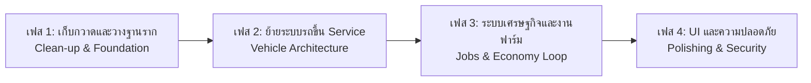

# 🚀 ARCH-02: Target Refactoring Roadmap (แผนงานปรับโครงสร้างสู่มาตรฐานโปรดักชัน)

> **แผนการดำเนินงาน 4 เฟส (4-Phase Action Plan)** เพื่อเปลี่ยน HOKI TOWN จาก Prototype ที่รับไม้ต่อ ให้กลายเป็นเกม Roleplay เต็มรูปแบบที่มีประสิทธิภาพสูงและรองรับผู้เล่นได้จริง  
> **Interactive Board:** [[KANBAN_Refactoring_Board|📋 เปิดกระดาน Kanban Board สำหรับติดตามงาน]]

---

## 📅 Roadmap Overview #roadmap

---

## 🛠️ เฟสที่ 1: การเก็บกวาดและวางฐานราก (Foundation & Clean-up) #phase1 #cleanup
*เป้าหมาย: หยุดข้อผิดพลาดพื้นฐานและสร้างจุดเริ่มต้นที่ปลอดภัยสำหรับผู้เล่น*

- [x] **1.1 ล้าง Ghost Welds และแก้ปัญหารถขยับไม่ได้:** ลบ WeldConstraint ที่ตรึงกับพื้นโลก ➕ 2026-11-04 ✅ 2026-11-05 #task #phase1 #priority/high #fixed
- [x] **1.2 แก้บั๊ก CarStatusGui Crash บรรทัดที่ 2:** ตรวจสอบ VehicleRef ให้พร้อมก่อนเรียกใช้งานแบบ Robust ➕ 2026-11-04 ✅ 2026-11-05 #task #phase1 #priority/critical #fixed
- [x] **1.3 ปรับปรุงระบบ Drive สไตล์ CDT Clean Arcade:** รองรับ Tap-to-Drift, Spacebar Sink และความเร็ว 280 km/h ➕ 2026-11-04 ✅ 2026-11-07 #task #phase1 #priority/critical #fixed
- [ ] **1.4 สร้าง SpawnLocation ถาวร:** สร้างจุดเกิดของผู้เล่นบริเวณหน้าโชว์รูมรถยนต์ พร้อมปิด `Neutral = true` และตั้ง `Transparency = 1` ⏳ 2026-11-12 🔼 #task #phase1 #priority/medium
- [ ] **1.5 จัดหมวดหมู่ Workspace:** ย้าย Part และ Model ลอยๆ เข้าสู่โฟลเดอร์ให้ชัดเจน: ⏳ 2026-11-14 🔼 #task #phase1 #priority/medium
  - `Workspace.Environment.Buildings` (ตึกแถว, บ้าน, โกดัง)
  - `Workspace.Environment.Roads` (ถนน 1,552 ท่อน, ฟุตบาท)
  - `Workspace.Environment.TerrainProps` (ภูเขา, เนินเขา)
  - `Workspace.Hazards` (ถังระเบิด)
  - `Workspace.InteractivePoints` (จุดเบิกรถ, จุดปั๊มน้ำ, ฟาร์ม)
- [ ] **1.6 ย้ายแอนิเมชั่นแท่นฟาร์มลง Client:** ย้ายสคริปต์ `TotemAnimation` จาก Workspace ไปไว้ที่ `StarterPlayerScripts` เพื่อให้ Client เป็นผู้รันการหมุน ลดโหลดเซิร์ฟเวอร์เหลือ 0% ⏳ 2026-11-15 🔼 #task #phase1 #priority/medium

---

## 🚗 เฟสที่ 2: ยกเครื่องระบบยานพาหนะ (Modern Vehicle Service) #phase2 #vehicle-architecture
*เป้าหมาย: รองรับการเบิกรถของผู้เล่นหลายคนพร้อมกันอย่างเป็นระบบ*

- [ ] **2.1 ย้ายโมเดลรถต้นแบบเข้า `ServerStorage`:** ลบรถที่วางทิ้งไว้ใน Workspace ทั้ง 2 คัน นำ `TeslaRoadster` ไปเก็บใน `ServerStorage.VehicleTemplates` ⏳ 2026-11-18 ⏫ #task #phase2 #priority/high
- [ ] **2.2 สร้าง `VehicleService` ใน `ServerScriptService`:** ควบคุมการ Spawn รถเมื่อผู้เล่นส่งคำขอผ่านจุด `Summon_Car`, ตรวจจับการชนรวมศูนย์ และ Despawn รถอย่างปลอดภัย ⏳ 2026-11-20 ⏫ #task #phase2 #priority/critical
- [ ] **2.3 ย้าย `CarStatusGui` ไปที่ `StarterGui`:** ไม่ต้องโคลนผ่านสคริปต์รถ ให้ GUI อยู่ใน `StarterGui` แล้วใช้ Attribute Listener แสดง/ซ่อนเมื่อขึ้น/ลงจาก `VehicleSeat` ⏳ 2026-11-22 🔼 #task #phase2 #priority/medium

---

## 🌾 เฟสที่ 3: ระบบเศรษฐกิจและงานฟาร์ม (Gathering & Economy Loop) #phase3 #economy
*เป้าหมาย: สร้าง Core Gameplay Loop ให้ผู้เล่นมีกิจกรรมทำในเมือง*

- [ ] **3.1 ติดตั้ง `ProximityPrompt` ที่แท่นฟาร์ม:** เชื่อม `FarmLungA` (ผลไม้รวม), `FarmBanana` (กล้วย), `FarmMelon` (เมล่อน) ให้ผู้เล่นกดเก็บเกี่ยวได้ ⏳ 2026-11-25 🔼 #task #phase3 #priority/high
- [ ] **3.2 สร้าง `InventoryService` และระบบกระเป๋า:** บันทึกจำนวนผลไม้และไอเทมที่เก็บได้ พร้อม GUI แสดงสิ่งของ ⏳ 2026-11-28 🔼 #task #phase3 #priority/high
- [ ] **3.3 สร้างจุดขายผลไม้ (Market / NPC Buyer):** นำผลไม้ที่เก็บได้จากฟาร์ม ขับรถขนส่งเข้าไปขายที่โกดัง FiveM เพื่อแลกเป็นเงิน Cash ⏳ 2026-12-01 🔼 #task #phase3 #priority/medium
- [ ] **3.4 เชื่อมโยงระบบปั๊มน้ำมัน (`GasTankSites`):** นำเงินที่ได้จากการฟาร์มไปเติมน้ำมันรถยนต์เมื่อน้ำมันใกล้หมด ⏳ 2026-12-03 🔽 #task #phase3 #priority/low

---

## 🔒 เฟสที่ 4: ความปลอดภัยและการจัดเก็บข้อมูล (Data Persistence & Security) #phase4 #security
*เป้าหมาย: ข้อมูลผู้เล่นไม่สูญหาย และป้องกันการโกง*

- [ ] **4.1 เชื่อมต่อ ProfileStore / DataStoreService:** บันทึกเงิน (Cash), รถที่เป็นเจ้าของ (OwnedVehicles), และไอเทมในตัว (Inventory) ⏳ 2026-12-08 ⏫ #task #phase4 #priority/critical
- [ ] **4.2 ตรวจสอบความถูกต้องฝั่งเซิร์ฟเวอร์ (Server Validation):** ไม่เชื่อถือข้อมูลความเร็วหรือดาเมจที่ส่งมาจาก Client ป้องกัน Exploit ⏳ 2026-12-10 ⏫ #task #phase4 #priority/critical
- [ ] **4.3 Mobile UI Polish:** ปรับแต่งหน้าปัดไมล์รถให้ไม่ทับปุ่มกระโดดหรือ Analog Stick บนหน้าจอมือถือทุกขนาด ⏳ 2026-12-12 🔼 #task #phase4 #priority/medium
