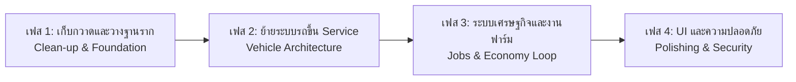

# 🚀 ARCH-02: Target Refactoring Roadmap (แผนงานปรับโครงสร้างสู่มาตรฐานโปรดักชัน)

> **แผนการดำเนินงาน 4 เฟส (4-Phase Action Plan)** เพื่อเปลี่ยน HOKI TOWN จาก Prototype ที่รับไม้ต่อ ให้กลายเป็นเกม Roleplay เต็มรูปแบบที่มีประสิทธิภาพสูงและรองรับผู้เล่นได้จริง

---

## 📅 Roadmap Overview

---

## 🛠️ เฟสที่ 1: การเก็บกวาดและวางฐานราก (Foundation & Clean-up)
*เป้าหมาย: หยุดข้อผิดพลาดพื้นฐานและสร้างจุดเริ่มต้นที่ปลอดภัยสำหรับผู้เล่น*

- [ ] **1.1 สร้าง SpawnLocation ถาวร:**
  - สร้างจุดเกิดของผู้เล่นบริเวณหน้าโชว์รูมรถยนต์ พร้อมปิด `Neutral = true` และตั้ง `Transparency = 1`
- [ ] **1.2 จัดหมวดหมู่ Workspace:**
  - ย้าย Part และ Model ลอยๆ เข้าสู่โฟลเดอร์ให้ชัดเจน เช่น:
    - `Workspace.Environment.Buildings` (ตึกแถว, บ้าน, โกดัง)
    - `Workspace.Environment.Roads` (ถนน 1,552 ท่อน, ฟุตบาท)
    - `Workspace.Environment.TerrainProps` (ภูเขา, เนินเขา)
    - `Workspace.Hazards` (ถังระเบิด)
    - `Workspace.InteractivePoints` (จุดเบิกรถ, จุดปั๊มน้ำ, ฟาร์ม)
- [ ] **1.3 ย้ายแอนิเมชั่นแท่นฟาร์มลง Client:**
  - ย้ายสคริปต์ `TotemAnimation` จาก Workspace ไปไว้ที่ `StarterPlayerScripts` เพื่อให้ Client เป็นผู้รันการหมุน ลดโหลดเซิร์ฟเวอร์เหลือ 0%

---

## 🚗 เฟสที่ 2: ยกเครื่องระบบยานพาหนะ (Modern Vehicle Service)
*เป้าหมาย: รองรับการเบิกรถของผู้เล่นหลายคนพร้อมกันอย่างเป็นระบบ*

- [ ] **2.1 ย้ายโมเดลรถต้นแบบเข้า `ServerStorage`:**
  - ลบรถที่วางทิ้งไว้ใน Workspace ทั้ง 2 คัน
  - นำ `TeslaRoadster` ไปเก็บใน `ServerStorage.VehicleTemplates`
- [ ] **2.2 สร้าง `VehicleService` ใน `ServerScriptService`:**
  - ทำหน้าที่ควบคุมการ Spawn รถเมื่อผู้เล่นส่งคำขอผ่านจุด `Summon_Car`
  - ตรวจจับการชนและคำนวณดาเมจแบบรวมศูนย์ (Centralized Collision Listener)
  - จัดการระบบทำลายรถ (Despawn) เมื่อผู้เล่นออกจากเกม หรือเมื่อรถพัง/ตกน้ำ
- [ ] **2.3 ย้าย `CarStatusGui` ไปที่ `StarterGui`:**
  - ไม่ต้องโคลนผ่านสคริปต์รถอีกต่อไป ให้ GUI อยู่ใน `StarterGui` แล้วใช้ Attribute Listener แสดง/ซ่อนเมื่อผู้เล่นขึ้น/ลงจาก `VehicleSeat`

---

## 🌾 เฟสที่ 3: ระบบเศรษฐกิจและงานฟาร์ม (Gathering & Economy Loop)
*เป้าหมาย: สร้าง Core Gameplay Loop ให้ผู้เล่นมีกิจกรรมทำในเมือง*

- [ ] **3.1 ติดตั้ง `ProximityPrompt` ที่แท่นฟาร์ม:**
  - `FarmLungA` (ลุงเอ) -> ให้กล้วย/ผลไม้รวม
  - `FarmBanana` (ฟาร์มกล้วย) -> ให้ผลกล้วย
  - `FarmMelon` (ฟาร์มเมล่อน) -> ให้เมล่อนสด
- [ ] **3.2 สร้าง `InventoryService` และระบบกระเป๋า:**
  - บันทึกจำนวนผลไม้และไอเทมที่เก็บได้
- [ ] **3.3 สร้างจุดขายผลไม้ (Market / NPC Buyer):**
  - นำผลไม้ที่เก็บได้จากฟาร์ม ขับรถขนส่งเข้าไปขายที่โกดัง FiveM หรือตลาดในเมืองเพื่อแลกเป็นเงิน
- [ ] **3.4 เชื่อมโยงระบบปั๊มน้ำมัน (`GasTankSites`):**
  - นำเงินที่ได้จากการฟาร์มไปเติมน้ำมันรถยนต์เมื่อน้ำมันใกล้หมด

---

## 🔒 เฟสที่ 4: ความปลอดภัยและการจัดเก็บข้อมูล (Data Persistence & Security)
*เป้าหมาย: ข้อมูลผู้เล่นไม่สูญหาย และป้องกันการโกง*

- [ ] **4.1 เชื่อมต่อ DataStoreService:**
  - บันทึกเงิน (Cash), รถที่เป็นเจ้าของ (OwnedVehicles), และไอเทมในตัว (Inventory)
- [ ] **4.2 ตรวจสอบความถูกต้องฝั่งเซิร์ฟเวอร์ (Server Validation):**
  - ไม่เชื่อถือข้อมูลความเร็วหรือดาเมจที่ส่งมาจาก Client ป้องกัน Exploit วิ่งเร็วเกินจริงหรือปั๊มเงิน
- [ ] **4.3 Mobile UI Polish:**
  - ปรับขนาดปุ่มบนหน้าปัดไมล์รถให้ไม่ทับปุ่มกระโดดหรือ Analog Stick บนมือถือ
