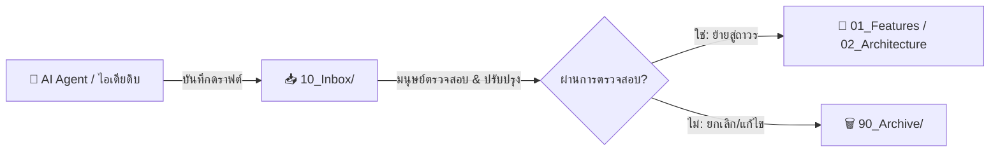

# 📥 10_Inbox — Raw Intake & AI Draft Staging

> **วัตถุประสงค์:** ใช้เป็นพื้นที่ปลอดภัย (Sandbox Staging) สำหรับบันทึกโน้ตดิบ ไอเดียใหม่ หรือเอกสารที่ AI Agent ร่างขึ้นมา ก่อนที่จะผ่านการตรวจสอบโดยมนุษย์และย้ายเข้าสู่โฟลเดอร์ถาวร

---

## 🛡️ Staging Workflow (กระบวนการคัดกรอง)

---

## 📝 กฎการตั้งชื่อไฟล์ใน Inbox
- เอกสารที่ AI ร่าง: `DRAFT_YYYY-MM-DD_TopicName.md`
- โน้ตย่อหรือไอเดียดิบ: `INBOX_TopicName.md`
