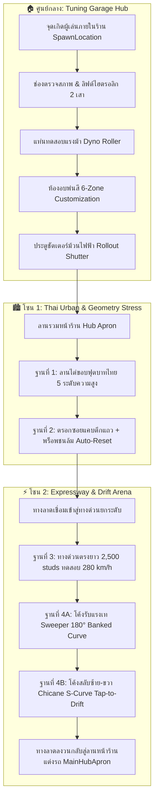

# 🏎️ รถ HOKI: Tuning Garage Hub & Comprehensive Vehicle Proving Grounds (พิมพ์เขียวระบบร้านแต่งรถและสนามทดสอบขับขี่ทุกสถานการณ์)

> **เป้าหมายหลัก:** แปลงแมพ `รถ HOKI` ให้เป็นศูนย์กลางการแต่งรถ (Customization & Tuning Workshop) และสนามทดสอบยานพาหนะระดับมาสเตอร์คลาส (Master Proving Grounds) ที่รองรับการจำลองทุกเงื่อนไขจริงจาก `[[FEAT_05_World_Map_Environment|HOKI TOWN]]`  
> **โมเดลเป้าหมาย:** `[[Tesla_Roadster_Raycast_Base_Model_2026|Tesla Roadster Raycast Base Model 2026]]`  
> **ระบบสีและพาร์ต:** `[[VehicleColorService]]` (6-Zone Dynamic Customization)  
> **ระบบควบคุมฟิสิกส์:** `[[FEAT_01B_CDT_Arcade_Vehicle_Overhaul|CDT Arcade]]` และ `[[FEAT_01D_Tesla_Raycast_Modular_Pipeline|Raycast Chassis Pipeline]]`

---

## 🗺️ 1. แผนผังภาพรวมการจัดวางโซน (Spatial Master Plan)

ผังสนามถูกออกแบบให้เป็น **Closed Loop Circuit** โดยมีศูนย์กลางอยู่ที่ **ร้านแต่งรถ (Tuning Garage Hub)** ผู้เล่นจะเริ่มเกมภายในอาคารร้าน และสามารถเลือกขับทดสอบได้ตาม 4 โซนเชื่อมต่อกันอย่างต่อเนื่อง:



---

## 🏠 2. เจาะลึกระบบร้านแต่งรถ (Tuning Garage Hub Architecture)

ร้านแต่งรถถูกวางให้เป็นจุดเกิดหลักของผู้เล่น (Default Player Spawn) เพื่อให้เกิดความรู้สึกเหมือนเป็นอู่แต่งรถสไตล์ Car Enthusiast / JDM & Euro Workshop

### 2.1 องค์ประกอบภายในอาคาร (Interior Layout)
1. **Spawn Location & Welcome Area:**
   - จุดเกิดผู้เล่นอยู่บนชั้นลอย (Mezzanine) หรือมุมห้องพักผ่อนที่มีกระจกมองเห็นโรงซ่อม
   - มีป้ายต้อนรับดิจิทัลซิงค์สเตตัสเซิร์ฟเวอร์
2. **2-Post Hydraulic Vehicle Lift (ลิฟต์ยกรถ 2 เสา):**
   - โมเดลเสาไฮดรอลิกคู่พร้อมแขนจับใต้ท้องรถ
   - ติดตั้ง `ProximityPrompt` ปุ่ม `[E] ยก/ลด ระดับรถ` เพื่อตรวจดูช่วงล่าง Raycast และใต้ท้องรถ
3. **Dyno Roller Platform (แท่นทดสอบแรงม้า):**
   - ลูกกลิ้งเหล็กฝังบนพื้นผิว พร้อมหน้าปัดวัดความเร็วรอบและแรงบิด (Torque/RPM Simulation)
   - หน้าจอ SurfaceGui แสดงกราฟแรงม้าจำลองและสปีดสูงสุด
4. **Paint & Customization Booth (ห้องพ่นสีปิดมิดชิด):**
   - โครงกระจกนิรภัยและหลอดไฟนีออนสว่างพิเศษ (Clean Room Lighting)
   - เชื่อมต่อกับ `[[VehicleColorService]]` รองรับการปรับแต่งสีสด 6 โซน:
     - `Body_Main`: สีตัวถังหลัก
     - `Aero_Trim`: ลิ้นหน้า, สเกิร์ต, ดิฟฟิวเซอร์
     - `Wheels_Rims`: แม็กซ์และขอบล้อ
     - `Brake_Calipers`: คาลิปเปอร์เบรก
     - `Lights_DRL`: เส้นไฟนีออน DRL
     - `Canopy_Glass`: กระจกและหลังคาแก้ว
5. **Rollout Shutter Door (ประตูม้วนทางออก):**
   - สวิตช์เซนเซอร์ตรวจจับเมื่อรถขับเข้าใกล้ ประตูจะเลื่อนเปิดขึ้นอัตโนมัติเพื่อออกสู่สนามทดสอบ

---

## 🧱 3. ฐานที่ 1: ลานไต่ขอบฟุตบาทไทยหลากระดับ (All-Level Curb Lab)

ออกแบบมาเพื่อทดสอบระบบ **CurbAssist** และขอบล่างของกล่อง `Chassis_Collider` โดยเฉพาะ ป้องกันไม่ให้รถบั๊กติดฟุตบาทเหมือนระบบ A-Chassis ทั่วไป

### 3.1 สเปกความสูง 5 ระดับ (Graduated Curb Heights)

| ระดับความสูง | ขนาดจริง (studs) | ตัวแทนสภาพแวดล้อมจริงในไทย | เกณฑ์การทดสอบ (Pass/Fail Criteria) |
| :--- | :---: | :--- | :--- |
| **ระดับ 1 (Micro)** | `0.5 stud` | หลังเต่าเข้าซอย / ทางลาดเชื่อมถนน | รถขับผ่านได้ 100% โดยไม่สะเทือนหรือสูญเสียความเร็ว |
| **ระดับ 2 (Standard)** | `1.0 stud` | ขอบฟุตบาท กทม. มาตรฐาน | CurbAssist ต้องตรวจพบและยกล้อหน้าขึ้นได้โดยกันชนไม่ขูด |
| **ระดับ 3 (Elevated)** | `1.5 stud` | ฟุตบาทถมคอนกรีต / ขอบทางลาดตึกแถว | กล่อง Collider หน้าสกีไม่ชนติด ล้อหน้าสามารถปีนขึ้นได้ |
| **ระดับ 4 (Median)** | `2.0 stud` | ขอบเกาะกลางถนนทรงสูง | ทดสอบขีดจำกัดช่วงล่าง รถไม่พลิกคว่ำหรือเด้งลอยข้ามเลน |
| **ระดับ 5 (Extreme)** | `2.5 stud` | แท่นแบริเออร์คอนกรีตต่ำ / ขั้นวิกฤต | บันทึกขีดจำกัดสูงสุดว่ารถปีนได้หรือไม่โดยไม่หลุดแมพ |

### 3.2 เลนทดสอบ 2 รูปแบบมุมเข้าปะทะ
* **Lane A (90° Direct Head-on):** ทางวิ่งหน้าตรงตั้งฉากกับขอบฟุตบาท ทดสอบมุมเงยหน้ารถ (Approach Angle)
* **Lane B (30° - 45° Angled Approach):** ทางเลี้ยวเทียบขอบฟุตบาทเฉียง ทดสอบการถ่ายเทน้ำหนักเมื่อล้อหน้าข้างเดียว (`Wheel_FL` หรือ `Wheel_FR`) ปีนขึ้นขอบก่อนอีกข้าง

---

## 🏘️ 4. ฐานที่ 2: ตรอกซอยแคบตึกแถว + พร็อพชนล้ม Auto-Reset (Soi Slalom)

จำลองสภาพซอยแคบระหว่างตึกแถวพาณิชย์ของ HOKI TOWN ที่มีสิ่งกีดขวางเต็มถนน พร้อมระบบรีเซ็ตพร็อพที่เบาเครื่อง 0% Lag

### 4.1 ข้อมูลรูปทรงตรอกซอย (Geometry Specs)
* **ความกว้างซอย (Soi Width):** `14 studs` (กว้างกว่าตัวรถ Tesla Roadster เพียง ~6 studs)
* **ความยาวตรอก (Soi Length):** `300 studs` มีจุดเลี้ยวหักศอก 90 องศา (Blind Corner) 2 จุด
* **ความสูงตึกขนาบข้าง:** ตึกแถว 3 ชั้น ความสูง `35 studs` พร้อมกันสาดหน้าร้านยื่นออกมา `4 studs` ที่ระดับความสูง `10 studs`
* **วัตถุประสงค์มุมกล้อง:** ตรวจสอบว่าระบบ `PopperCam` ของกล้องมุมมองบุคคลที่สามไม่กระตุกพุ่งชนศีรษะคนขับเวลาเลี้ยวในซอยแคบ

### 4.2 ระบบพร็อพชนล้มและฟื้นฟูไว (Fast Zero-Lag Prop Reset Engine)

```text
[รถพุ่งชนพร็อพ] ──► [ตรวจพบการเคลื่อนที่ > 2 studs หรือเอียง > 25°]
                            │
                            ▼
                    [เริ่มตัวนับถอยหลัง 3 วินาที]
                            │
                            ▼
                 [เช็กว่ารถยังทับอยู่หรือไม่?]
                   ├── ใช่ ──► รออีก 1 วินาที
                   └── ไม่ ──► [ดึง CFrame กลับตำแหน่งเดิมทันที]
                               [Set AssemblyLinearVelocity = 0]
                               [Set AssemblyAngularVelocity = 0]
```

#### กฎเหล็กป้องกันการ Lag และ Memory Leak:
1. **Zero Instance Allocation:** ไม่มีการใช้ `Instance.new()`, `Clone()`, หรือ `Destroy()` พร็อพชิ้นเดิมจะอยู่ถาวร
2. **Local CFrame Cache:** สคริปต์กลางตัวเดียว (`FastPropResetManager`) บันทึก `[Instance] = OriginalCFrame` ไว้ใน Table ล่วงหน้า
3. **No Collision Spam:** เมื่อชนแล้ว พร็อพจะเปลี่ยนค่า `CanTouch = false` ชั่วคราว 0.5 วินาที เพื่อไม่ให้ยิง Event Touch ถี่เกินไป

---

## 🛣️ 5. ฐานที่ 3: ทางด่วนตรงยาว > 2,000 studs (High-Speed Expressway)

สนามประลองความเร็วสูงสุดและสมรรถนะการเบรกของยานพาหนะ

### 5.1 สเปกของทางด่วน
* **ระยะทางตรงยาวรวม:** `2,500 studs` (เทียบเท่าประมาณ 700+ เมตรในชีวิตจริง)
* **ความกว้างถนน:** `36 studs` (แบ่งเป็น 3 ช่องจราจร เลนละ 12 studs) พร้อมแผงกั้นข้างทางคอนกรีต (Jersey Barrier)
* **ระยะปลอดภัยปลายทาง (Run-off Stopping Zone):** `500 studs` มีลานกรวดชะลอความเร็ว (Gravel Trap) และกำแพงยางกันกระแทก

### 5.2 ระบบวัดค่าสถิติ (Speed & Telemetry Traps)
* **Trap 1 (400 studs):** วัดอัตราเร่ง 0-100 กม./ชม.
* **Trap 2 (1,200 studs):** วัดอัตราเร่ง 100-200 กม./ชม.
* **Trap 3 (2,000 studs):** วัดความเร็วสูงสุด (Top Speed 280 km/h) และความนิ่งของตัวถัง (Downforce / Chassis Stability)
* **Braking Zone:** จุดป้ายเตือนเริ่มเหยียบเบรกมิดคันเร่ง พร้อมแถบวัดระยะเบรกทุกๆ 10 studs จนถึงจุดหยุดนิ่ง

---

## 🔄 6. ฐานที่ 4: โค้งต่อเนื่อง Sweeper & Chicane (Drift S-Curve)

ทดสอบระบบ **Tap-to-Drift**, การสไลด์ตัวถัง, ควันยางแนบพื้น (`ground-anchored smoke`), และการรักษาการยึดเกาะ

### 6.1 โค้งกว้างรับแรงเท (180° Banked Sweeper)
* **รัศมีโค้ง (Radius):** กว้าง `120 studs`
* **องศาเอียงรับแรงเท (Banking Angle):** พื้นถนนเอียงเข้าหาจุดศูนย์กลางโค้ง `5 องศา`
* **ความเร็วที่รองรับ:** สามารถเข้าโค้งด้วยความเร็ว `120 - 150 กม./ชม.` ได้โดยรถไม่หลุดเหวี่ยงตกถนน

### 6.2 โค้งสลับทิศทาง (Chicane S-Curve)
* **ระยะทางเปลี่ยนทิศ:** โค้งซ้ายหักสลับขวาระยะกระชั้นชิดในระยะ `150 studs`
* **การทดสอบน้ำหนักรถ (Weight Transfer):**
  - ตรวจสอบว่าเมื่อผู้เล่นแตะเบรกสั้น (Tap) เพื่อสะบัดท้ายไปทางซ้าย แล้วหักพวงมาลัยสลับขวากะทันหัน
  - ระบบคืนแรงยึดเกาะ (Restore Grip) ต้องไม่ทำให้รถสะบัดหมุนคว้าง (Snap Oversteer / 360 Spin)

---

## 🤖 7. ขั้นตอนการใช้ OpenCode ดำเนินการ (OpenCode Work Order Breakdown)

เมื่อเริ่มการพัฒนา เราจะสั่งการผ่าน **OpenCode CLI (v1.19.5)** เพื่อแยกชิ้นงานอย่างเป็นระบบ:

1. **Work Order 1: `build-tuning-garage`**
   - สร้างโมเดลอาคารอู่แต่งรถ, วางจุดเกิด `SpawnLocation`, ติดตั้งลิฟต์ยกรถ และประตูชัตเตอร์ม้วนไฟฟ้า
2. **Work Order 2: `build-curb-lab`**
   - สร้างขั้นฟุตบาท 5 ระดับ (0.5, 1.0, 1.5, 2.0, 2.5 studs) และเลนทดสอบ 90° กับ 45°
3. **Work Order 3: `build-soi-slalom-with-reset`**
   - วางแนวตึกแถวซอยแคบ 14 studs พร้อมสคริปต์ `FastPropResetManager.luau` ควบคุมพร็อพแบบไม่แล็ก
4. **Work Order 4: `build-expressway-and-drift-ring`**
   - ลากถนนตรงยาว 2,500 studs + โค้ง Banked Sweeper และ Chicane S-Curve วนลูปกลับเข้าหน้าร้าน

---

## 📌 สถานะเอกสาร
- **เอกสารนี้เป็น Single Source of Truth (SSOT)** สำหรับการอัปเกรดแมพ `รถ HOKI`
- ยึดมั่นตามข้อตกลงในการคุย: **ไม่เพิ่มสิ่งไม่จำเป็น (YAGNI)**, **เน้น 4 ฐานหลัก**, และ **เจาะลึกระบบร้านแต่งรถในเฟสถัดไป**
