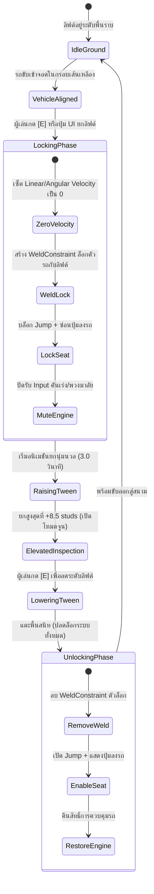

# 🏢 สถาปัตยกรรมร้านแต่งรถ HOKI APEX PERFORMANCE & กลไกลิฟต์ไฮดรอลิก (Anti-Bug & Smooth Animation)

> **เป้าหมาย:** ออกแบบอู่แต่งรถสไตล์ Thai Modern Industrial Loft พร้อมระบบกลไกลิฟต์ยกรถ 2 เสา (`Hydraulic Lift System`) ที่มีอนิเมชันนุ่มนวลระดับภาพยนตร์ (Cinematic Smoothness) และมีระบบล็อกตัวรถ (Model Freeze) ป้องกันรถดิ้น/สะบัด/หลุดออกนอกแมพ พร้อมระบบล็อกคนขับไม่ให้หลุดหรือกดลงจากรถขณะกำลังยกหรือปรับแต่ง

---

## 🏗️ 1. รายละเอียดสถาปัตยกรรมและผังอาคาร (Architectural Layout)

```text
+-----------------------------------------------------------------------------------+
|                            HOKI APEX PERFORMANCE (อู่หลัก)                          |
+-----------------------------------------------------------------------------------+
|  [ชั้น 2: Mezzanine VIP Lounge & Spawn]                                           |
|   - พื้นไม้ปาร์เกต์ + กระจกบานใหญ่ Curtain Wall มองทะลุเห็นแท่นซ่อมด้านล่าง       |
|   - โซฟาหนัง, บาร์กาแฟ, จอคอมมูนิตี้ FiveM และบันไดเหล็กวนลงสู่ชั้น 1             |
+-----------------------------------------------------------------------------------+
|  [ชั้น 1: Main Workshop Floor]                                                    |
|                                                                                   |
|    [ Bay 1: Staging Pad ]      [ Bay 2: Hydraulic Lift ]   [ Bay 3: Paint Booth ]|
|    - จุดจอดรอส่งมอบ            - เสาคู่ลิฟต์ไฮดรอลิก        - ห้องอบสีคลีนรูม     |
|    - สปอตไลต์ Daylight         - ตรวจช่วงล่าง/โหลดเตี้ย    - 6-Zone Customizer   |
|                                                                                   |
|    [ Bay 4: Dyno Simulator ]                              [ Bay 5: Power Gate ]  |
|    - ลูกกลิ้งเหล็กคู่ทดสอบแรงม้า                           - ประตูชัตเตอร์ม้วน    |
|    - จอกราฟแรงบิด/ท็อปสปีด 280 km/h                        - เปิดพุ่งสู่สนาม      |
+-----------------------------------------------------------------------------------+
```

---

## ⚙️ 2. กลไกลิฟต์ยกรถ 2 เสา (Hydraulic Lift State Machine)

ระบบลิฟต์ถูกควบคุมผ่านวงจร State Machine 5 ขั้นตอน เพื่อตัดปัญหาฟิสิกส์กระตุก (Physics Glitch / Fling / Clamping) 100%:



---

## 🔒 3. กฎเหล็กป้องกันบั๊ก 3 ชั้น (Triple Anti-Glitch Protocol)

### ชั้นที่ 1: ระบบล็อกตัวถังรถ (Structural Model Lock)
* **ปัญหาเดิม:** การใช้ฟิสิกส์ธรรมดา (เช่น Physics Collision หรือ Constraints หลวมๆ) ยกรถ จะทำให้ล้อที่หมุนหรือระบบ Raycast เกิดแรงสะท้อน (Physics Spasm) จนรถกระเด็นหลุดจากแขนลิฟต์
* **แนวทางแก้ไขระดับ Production:**
  1. เมื่อเริ่มยก สคริปต์เซิร์ฟเวอร์จะสร้าง `WeldConstraint` เชื่อมระหว่าง `Chassis_Collider` (RootPart ของรถ) กับ `Lift_Carriage_Platform` (แกนกลางของลิฟต์)
  2. สั่งปิดฟิสิกส์ช่วงล่างชั่วคราว (`RaycastSuspensionEnabled = false`) เพื่อไม่ให้ยิง Ray ดันตัวรถแข่งกับแขนลิฟต์
  3. ผลลัพธ์: ตัวรถจะผสานเป็นเนื้อเดียวกับแขนลิฟต์ เคลื่อนที่ตามแกนอย่างมั่นคง 100% ไม่มีทางร่วงหรือสั่น

---

### ชั้นที่ 2: ระบบล็อกคนขับ (Seat Lockout & Anti-Eject Protection)
* **ปัญหาเดิม:** เมื่อผู้เล่นกดปุ่มกระโดด (Spacebar / ปุ่ม Jump มือถือ) สคริปต์ `PlayerModule` ของ Roblox จะสั่งตัด `SeatWeld` ทิ้งอัตโนมัติ ทำให้ผู้เล่นกระเด็นหลุดจากรถตกลงมาข้างล่าง หรือติดบั๊กทะลุหลังคา
* **แนวทางแก้ไข:**
  1. **Client-side Jump Sinking:** สั่ง `Humanoid:SetStateEnabled(Enum.HumanoidStateType.Jumping, false)` บนตัวละคร
  2. **ContextActionService Priority:** ดักปุ่ม Spacebar และปุ่มสัมผัสบนมือถือด้วย Priority สูงสุด
  3. **Mobile UI Masking:** สั่งซ่อนปุ่ม `[🚪 ลงจากรถ]` (`MobileExitButton.Visible = false`) ตลอดเวลาที่ลิฟต์ไม่ได้อยู่ที่ระดับพื้น
  4. **Server Fallback Guard:** ฝัง Event ตรวจจับ `DriveSeat.ChildRemoved` หาก `SeatWeld` มีแนวโน้มจะหลุด เซิร์ฟเวอร์จะตรึง `HumanoidRootPart` ไว้ที่เบาะทันที พร้อมขึ้นข้อความแจ้งเตือน:
     > ⚠️ **"กำลังตรวจสภาพช่วงล่างบนลิฟต์ — กรุณาลดระดับลิฟต์ลงก่อนลงจากรถ"**

---

### ชั้นที่ 3: ระบบตัดกำลังขับเคลื่อน (Drive Input Neutralization)
* ขณะอยู่บนลิฟต์ สคริปต์จะตั้งค่าแอตทริบิวต์:
  ```lua
  car:SetAttribute("VehicleControlLocked", true)
  ```
* เมื่อค่านี้เป็น `true`:
  - แป้นคันเร่งและเบรกจะถูก Bypass ไม่ส่งแรงขับเคลื่อนไปยัง Raycast Engine
  - ล้อจะไม่หมุนฟรีจนเกิดควันยางกวนสายตา
  - พวงมาลัยสามารถหมุนเลี้ยวโชว์ได้ (Visual Steer Only) เพื่อตรวจเช็คระยะเลี้ยวของมุมล้อ

---

## 🎬 4. อนิเมชันไฮดรอลิกนุ่มนวล (Cinematic Tween Animation)

การเคลื่อนที่ของลิฟต์จะใช้ `TweenService` ที่จูนจังหวะการเคลื่อนที่อย่างพิถีพิถัน:

### 4.1 สเปกของ Tween
* **เป้าหมาย:** ขยับชิ้นส่วน `Lift_Carriage_Assembly` ขึ้นแกน Y จาก `Y = 0` ถึง `Y = +8.5 studs`
* **ระยะเวลา (Duration):** `3.0 วินาที` (ความเร็วที่สมจริง ไม่ช้าจนน่าเบื่อ และไม่เร็วจนกระตุก)
* **Easing Curve:**
  - `EasingStyle = Enum.EasingStyle.Sine` (การเร่งความเร็วและชะลอหยุดแบบคลื่นไซน์ นุ่มนวลไร้รอยต่อ)
  - `EasingDirection = Enum.EasingDirection.InOut`

### 4.2 ระบบเสียงประกอบ (Sound & Haptic Synthesis)
1. **จังหวะเริ่มยก (T = 0.0s):**
   - เสียงวาล์วไฮดรอลิกเปิดรับแรงดัน: `Sound_Hydraulic_Engage.mp3` (เสียงลมฟู่สั้นๆ)
2. **จังหวะกำลังยก (T = 0.2s - 2.8s):**
   - เสียงปั๊มมอเตอร์ไฟฟ้าไฮดรอลิกทำงานต่อเนื่อง: `Sound_Motor_Loop.mp3` (ความถี่คงที่ นุ่มลึก)
   - ไฟสัญญาณหมุนสีส้ม (Amber Strobe Beacon) บนยอดเสาลิฟต์เริ่มกะพริบเตือนความปลอดภัย
3. **จังหวะถึงจุดสูงสุด (T = 3.0s):**
   - เสียงกลไกสลักฟันปลา Safety Ratchet ล็อกเข้าล็อก: `Sound_Mechanical_Latch.mp3` (เสียงคลิกเหล็กหนักแน่น)
   - สปอตไลต์ LED ใต้ท้องรถ (Undercarriage Worklights) สว่างขึ้นอัตโนมัติ

---

## 🎛️ 5. ฟังก์ชันที่จะปรับแต่งได้ขณะอยู่บนลิฟต์ (Suspension Tuning Menu)

เมื่อลิฟต์ยกตัวขึ้นสู่ตำแหน่งสูงสุด หน้าจอ UI ปรับแต่งช่วงล่างจะปรากฏขึ้นบนหน้าจอของผู้เล่น:

| รายการปรับแต่ง (Tuning Item) | ตัวเลือกค่า (Range / Options) | ผลลัพธ์ในระบบฟิสิกส์ (Effect on Physics) |
| :--- | :---: | :--- |
| **Ride Height (ความสูงใต้ท้อง)** | `0.8 - 2.2 studs` | ปรับระยะจุดยิง Raycast (โหลดเตี้ยมุดซอย vs ยกสูงปีนฟุตบาท) |
| **Spring Stiffness (ความตึงสปริง)** | `Soft / Balanced / Stiff` | กำหนดการซับแรงกระแทกเวลาตกหลุมหรือจั๊มป์สะพาน |
| **Damping Ratio (แรงหน่วงสปริง)** | `0.6 - 1.2` | ป้องกันไม่ให้รถเด้งสั่นเป็นลูกปิงปองหลังลงจากฟุตบาท |
| **CurbAssist Sensor Angle** | `30° / 45° / 60°` | องศาการยิง Ray หน้าเพื่อตรวจจับขอบฟุตบาทล่วงหน้า |
| **Visual Camber (มุมเอียงล้อ)** | `-4° ถึง 0°` | องศาล้อแบะสไตล์รถแต่ง VIP / Track Stance สวยงาม |

---

## 📋 แผนการส่งมอบงานสู่ OpenCode

โค้ดควบคุมระบบลิฟต์ทั้งหมดจะถูกเขียนในรูปแบบโมดูลาร์:
* **Server Controller:** `src/ServerScriptService/LiftService/HydraulicLiftController.server.luau`
* **Client Interface:** `src/StarterPlayerScripts/LiftClient/LiftInteractionClient.client.luau`
* **Shared Network Events:** `ReplicatedStorage.Remotes.ToggleLiftEvent`
