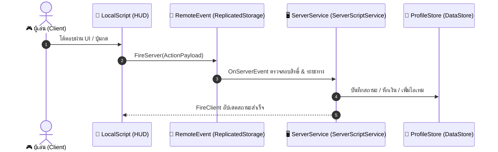

# 🚀 <% tp.file.title %>

> **ตำแหน่งใน DataModel:** `<% tp.frontmatter.datamodel_location %>`  
> **สถานะการพัฒนา:** 🟡 อยู่ระหว่างการพัฒนา (Prototype) #in-progress  
> **ผู้รับผิดชอบ / แผนงาน:** [[ARCH_02_Target_Refactoring_Roadmap|🚀 Refactoring Roadmap]] | [[KANBAN_Refactoring_Board|📋 Kanban Board]]

---

## 1. วัตถุประสงค์และภาพรวมระบบ (Feature Overview & Purpose) #overview
- **เป้าหมายของฟีเจอร์:** อธิบายสั้นๆ ว่าระบบนี้มอบประสบการณ์อะไรให้แก่ผู้เล่นใน HOKI TOWN
- **การเชื่อมโยงกับ Core Loop:** เชื่อมโยงกับการขับขี่ (Driving), การฟาร์ม (Farming), หรือการสวมบทบาท (Roleplay) อย่างไร

---

## 2. โครงสร้างอ็อบเจ็กต์ใน DataModel (Hierarchy & Instances) #datamodel

```text
Workspace/
└── <% tp.frontmatter.datamodel_location.replace('Workspace.', '') %>/
    ├── HitboxPart (Anchored = true, CanCollide = false)
    ├── ProximityPrompt (ActionText, ObjectText, HoldDuration)
    └── Script / LocalScript
```

---

## 3. การแบ่งหน้าที่ Client vs Server (Architecture & Networking) #architecture



---

## 4. กฎฟิสิกส์และสูตรคำนวณ (Physics & Mathematics) #math
- **สูตรคำนวณ / ตัวแปรควบคุม:**
  - ตัวแปรที่ 1: ...
  - ตัวแปรที่ 2: ...

---

## 5. การป้องกันการโกงและจุดเสี่ยง (Anti-Exploit & Edge Cases) #security
- [ ] **Sanitize Arguments:** ตรวจสอบชนิดข้อมูลและขอบเขตตัวเลขจาก Client เสมอ
- [ ] **Magnitude Check:** ผู้เล่นต้องอยู่ในระยะห่างที่ถูกต้อง (< 15 studs) ก่อนอนุมัติ Action
- [ ] **Cooldown Throttling:** ป้องกันการกดสแปมคำขอรัวๆ

---

## 6. แผนงานการพัฒนาและขั้นตอนทดสอบ (Tasks & Test Checklist) #tasks

- [ ] **Phase 1:** วางโมเดลและ Hitbox ใน Workspace พร้อมตั้งค่าฟิสิกส์ถูกต้อง ⏳ <% tp.date.now("YYYY-MM-DD", 7) %> #task #priority/high
- [ ] **Phase 2:** สร้าง RemoteEvents ใน `ReplicatedStorage.Remotes` ⏳ <% tp.date.now("YYYY-MM-DD", 10) %> #task #priority/high
- [ ] **Phase 3:** เขียน Service ควบคุมบน `ServerScriptService` ⏳ <% tp.date.now("YYYY-MM-DD", 14) %> #task #priority/critical
- [ ] **Phase 4:** ทดสอบบน Studio Sandbox ทั้งบน PC และ Mobile Device ⏳ <% tp.date.now("YYYY-MM-DD", 18) %> #task #priority/medium
